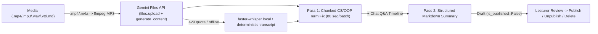

# Engineering Design Document (EDD) — ClassPulse

**Chain Role:** `4. EDD (Detail)` — *How is each component built internally?*  
**Upstream:** [`docs/software_design_and_architecture.md`](software_design_and_architecture.md) | **Downstream:** [`docs/api_reference.md`](api_reference.md)

---

## 1. Rolling QR & Anti-Proxy Engine (`qr_service.py`, `attendance_service.py`)

- **Bucket & Signature Math:** Time is quantized into 5-second windows `bucket = floor(unix_ts / QR_STEP_SECONDS)`. Tokens use truncated `HMAC-SHA256(SECRET_KEY, f"{session_code}:{bucket}")[:16]`.
- **Grace Acceptance:** Verification accepts `[curr - QR_GRACE_BUCKETS .. curr]` (default `6`, tunable via `.env`), absorbing phone focus and TLS handshake latency without accepting stale codes from hours earlier.
- **Anti-Proxy & Identity Resolution (`identity_helpers.py`):**
  1. `normalize_student_id` strips whitespace/hyphens and uppercases (`STUDENT_ID_RE`: `4–32` alphanumeric).
  2. First-time scan resolves or creates `Student` and sets `cp_device` cookie.
  3. Any second student using the same `(session_id, device_id)` triggers `ProxyAttendanceBlockedError` (`HTTP 409`).
  4. `elapsed_minutes > ClassSession.late_after_minutes` sets `AttendanceRecord.is_late = True`.

---

## 2. Tiled SCRFD Vision & Phone Camera Companion (`face_counter.py`, `reconciler.py`)

1. **Multi-Scale Tiling + IoU NMS:** `TiledSCRFDDetector` runs SCRFD (`det_10g`, threshold `0.35`, `det_size=(640, 640)`) on the full image plus an overlapping `3x2` crop grid (`20%` overlap). Overlapping seam detections are deduplicated via IoU NMS (`iou >= 0.40`).
2. **Mobile Orientation Recovery (`detect_with_orientation`):** Checks EXIF orientation and probes 90°/180°/270° rotations if initial upright face count is zero, normalizing the stored raw JPEG upright so `<canvas>` overlays align pixel-for-pixel.
3. **Phone Camera Pairing (`/headcount-cam/<code>`):**
   - Laptop generates a signed `ctok` (`session_id`, `session_code`, `nonce`, 30-min TTL) QR + SVG.
   - Opening the page flips pairing status `connected=True`, auto-closing the desktop modal.
   - `image_compress.js` resizes client-side to `<=1280px` JPEG before upload; phone preview supports `+1/-1` manual adjustment (`PATCH /api/headcount-cam/<code>`, floored at `0`).
4. **Reconciliation Verdict (`reconciler.py`):**
   - $\Delta = N_{\text{QR}} - N_{\text{Visual}}$, `excess = max(0, delta)`.
   - $|\Delta| \le \text{tolerance} \Rightarrow$ `VERIFIED`; $\Delta > \text{tolerance} \Rightarrow$ `DISCREPANCY_ALERT`; $\Delta < -\text{tolerance} \Rightarrow$ `UNDER_SCANNED`.
   - When `qr_count > visual_count` and not yet approved, `discrepancy_requires_approval = True` until lecturer calls `/approve-discrepancy`.

---

## 3. Real-Time Socket.IO Hub & Client Notifications (`app/sockets/`, `notifications.js`)

- **Room Topology:**
  - `session_<code>`: receives `qr:rotate`, `attendance:count_update`, `headcount:updated`, `poll:*`, `chat:new`, `chat:updated`, `lecture:status`, `lecture:summary_ready`, `lecture:unpublished`, `lecture:deleted`.
  - `course_notify_<course_id>` & `lecturer_notify_<lecturer_id>`: deliver cross-lecture badges/toasts and live `lecture:unpublished` / `lecture:deleted` eviction even when viewing another lecture or course home.
- **Client Cache Epoch (`notifications.js`):** On page boot, compares `localStorage.cp_storage_epoch` against `CP_STORAGE_EPOCH`; mismatched values clear stale `cp_*` keys and `sessionStorage` cleanly once without affecting unrelated keys.

---

## 4. Video/Audio Transcription & Summary Pipeline (`lecture_pipeline.py`, `llm_client.py`)

- **Quota Resilience (`llm_client.py`):** Detects `RESOURCE_EXHAUSTED` / daily free-tier exhaustion (`GenerateRequestsPerDay`) and fails over immediately (`gemini-2.5-flash-lite` -> `gemini-2.5-flash`) without multi-second retry stalls. If all remote LLMs are unavailable, the local content-grounded summarizer extracts actual spoken terms rather than placeholder text.
- **Structured Cards & Sync:** `parse_summary_sections` splits Markdown into `executive_summary`, `key_topics`, `action_items`, and `extra_sections`. New summaries start as `is_published=False`; toggling `/publish` emits `lecture:summary_ready` or `lecture:unpublished`; `DELETE` removes the media file from disk and emits `lecture:deleted`.

---

## 5. Comparative vs. Final Homework Engine (`homework_pipeline.py`)

- **Ingestion & Security (`SubmissionExtractor`):** Extracts `.py`, `.java`, `.md`, `.txt`, `.pdf`, `.docx`, `.zip` (ignoring `.git/`, `node_modules/`, `__pycache__/`, `.venv/`) and GitHub zipballs. Corrupt `.zip`/`.docx` files raise `HomeworkPipelineError(..., 400)`. Uploads save cleanly inside `UPLOAD_DIR/course_<cid>/assignment_<aid>_num_<num>_<slug>/<submission_type>/`.
- **Stage 1 (Single Submission):** Gemini produces strict Pydantic schema JSON (`HomeworkMetricsResponse`, no `additionalProperties`) with fallback AST/heuristic grading for deterministic offline scoring.
- **Incremental $O(1)$ Cohort Math (`CohortAggregator`):**
  - Comparative submissions update `ClassStatsAggregate` (`submission_count`, `scores_list_json`, topic sums/lists, category distributions, error tag counts) in $O(1)$. Resubmissions call `revert_metrics` before `apply_metrics` so averages and counts remain exact.
  - Dynamic 1–10 Class Standing + Ordinal Rank (`1st`, `2nd`, `3rd`, handling `11th`–`13th` exceptions cleanly) are computed strictly for `submission_type="comparative"`.
- **Stage 2 Privacy & Separation:** Stage-2 prompts receive anonymized cohort snapshots (zero peer names/emails/code). `final` submissions track independent version numbers, never mutate `ClassStatsAggregate`, carry no class rank, and are the **only** submissions visible or downloadable by lecturers.

---

## 6. Automated Fault Localization Harness (`tests/diagnostics.py`, `run_all_tests.py`)

- **HTTP Trace & Traceback Filtering:** `conftest.py` wraps `FlaskClient.open` (skipping streamed file responses) to record the last 6 API calls per test and filters framework frames (`site-packages`, `_pytest`, `werkzeug`, `sqlalchemy`) to pinpoint the innermost `app/` source line or exact `tests/` assertion line.
- **Root-Cause Classifier:** Maps failures to `HTTP 500 Internal Server Error`, `Missing Key / Schema Error`, `Data Isolation / RBAC Breach`, `Database / SQLAlchemy Session Error`, `Timeout / Async Hang`, `Frontend JS Unit Failure`, or `Assertion Mismatch`, rendering compact terminal cards (`Where`, `Why`, `Diff`, `HTTP`, `Code`, `Hint`) plus JSON logs in `tests/logs/`.
