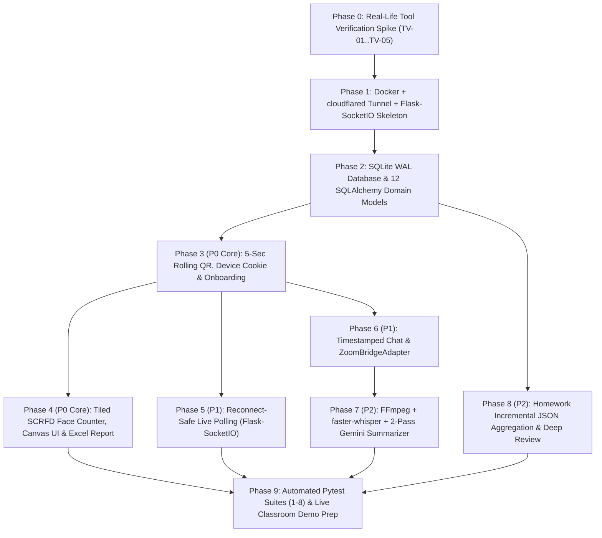
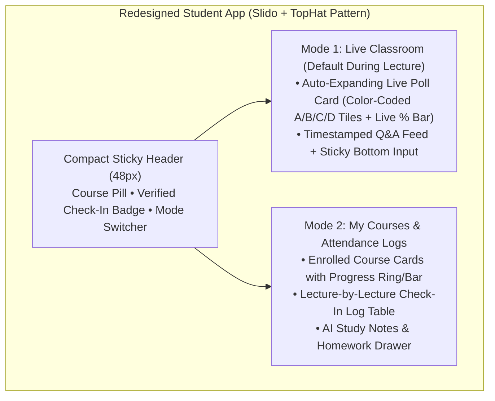
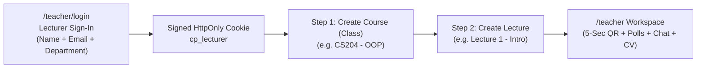
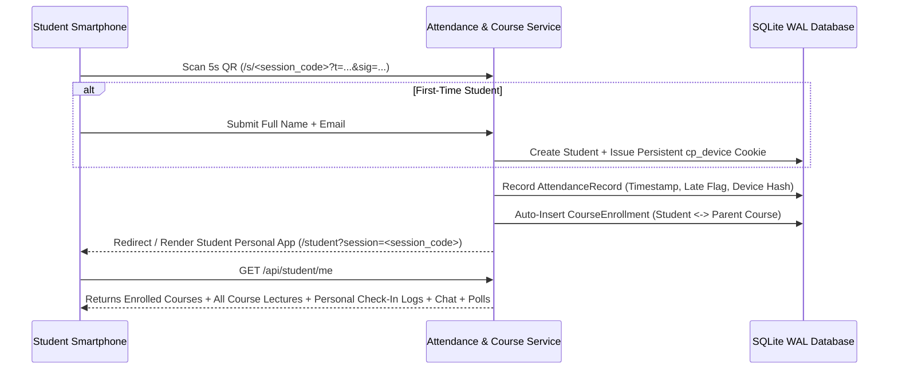
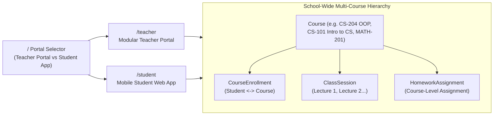
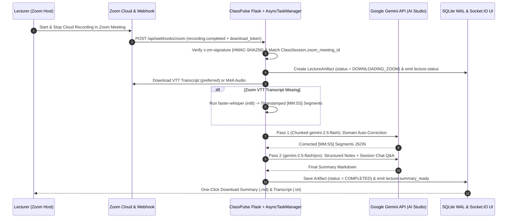

# Step-by-Step Implementation Plan — ClassPulse

**Document ID:** `Ex1-IMP-1.0`  
**Course:** Introduction to Software Engineering (OOP / OOD) — Ex2  
**Author:** Ohad Ben Nun

---

## 1. System Overview & Implementation Roadmap

**ClassPulse** was originally built in **9 sequential, testable phases** (with Phases 10–13 extending it into a multi-course cloud platform), ordered by risk and priority: **Infrastructure & Real-Life Tool Verification** first, followed by **Feature 1 (5-Second Rolling QR Attendance + Tiled Computer-Vision Headcount & Excel Report)** as the P0 core, then **Real-Time Engagement (Features 3 & 2)**, **Post-Class AI Pipelines (Features 4 & 5)**, and **End-to-End Automated Zoom Cloud & Gemini Integration (Phase 13)**.



### Component-to-Phase Mapping

| Phase | Priority | Target Components & Classes | Primary Files Created |
| :--- | :--- | :--- | :--- |
| **Phase 0** | **Pre-Code** | Tool Verification Scripts (`SCRFD`, `cloudflared`, `google-genai`) | `scripts/verify_tools.py`, `reports/tool_verification_results.md` |
| **Phase 1** | **P0 Core** | Docker Stack, Tunnel Sidecar, App Factory, `AsyncTaskManager` | `Dockerfile`, `docker-compose.yml`, `requirements.txt`, `app/__init__.py`, `app/config.py`, `app/services/task_runner.py` |
| **Phase 2** | **P0 Core** | SQLite WAL Engine + All 12 ORM Domain Entities | `app/models.py` |
| **Phase 3** | **P0 Core** | `RollingQRService`, `DeviceBindingManager`, `AttendanceService` | `app/services/qr_service.py`, `app/services/attendance_service.py`, `app/routes/attendance.py`, `app/sockets/session_events.py` |
| **Phase 4** | **P0 Core** | `TiledSCRFDDetector`, `AttendanceReconciler`, `SpreadsheetExporter` | `app/services/face_counter.py`, `app/services/reconciler.py`, `app/services/report_exporter.py`, `app/static/js/headcount_canvas.js` |
| **Phase 5** | **P1 Live** | `PollService`, Socket.IO Poll Events & Reconnect Hydration | `app/services/poll_service.py`, `app/routes/polls.py`, `app/sockets/poll_events.py` |
| **Phase 6** | **P1 Live** | `ChatService`, `ZoomBridgeAdapter` (`NoOp` & `ZoomOAuthRestBridge`) | `app/services/chat_service.py`, `app/services/zoom_bridge.py`, `app/sockets/chat_events.py` |
| **Phase 7** | **P2 AI** | `GeminiStudioClient`, `LectureSummarizerService` (`faster-whisper`) | `app/services/llm_client.py`, `app/services/lecture_pipeline.py`, `app/routes/lectures.py` |
| **Phase 8** | **P2 AI** | `SubmissionExtractor`, `HomeworkMetrics`, `CohortAggregator`, `HomeworkReviewService` | `app/services/homework_pipeline.py`, `app/routes/homework.py` |
| **Phase 9** | **QA & Demo** | STP Test Suites 1–8 (`pytest`) & One-Click Demo Seeder | `tests/test_*.py`, `run_all_tests.py`, `scripts/seed_demo.py` |
| **Phase 10A** | **School-Wide** | Multi-Course & Enrollment ORM (`Course`, `CourseEnrollment`, `Course.course_code`) | `app/models.py`, `app/services/course_service.py`, `app/routes/courses.py` |
| **Phase 10B** | **Teacher Portal** | Modular Teacher Workspace (Course Switcher + 5-Tab Workspace) | `app/templates/teacher_portal.html`, `app/static/js/teacher_portal.js` |
| **Phase 10C** | **Student App** | Mobile Student Web App (`/student` with My Classes, QR Check-In, Live Class, AI Notes, Homework) | `app/templates/student_app.html`, `app/static/js/student_app.js` |
| **Phase 11A** | **Lecturer Auth** | `Lecturer` ORM Entity, Signed `cp_lecturer` Cookie, Lecturer Sign-In Page (`/teacher/login`) & Guided Course -> Lecture Creation Flow | `app/models.py`, `app/services/course_service.py`, `app/routes/courses.py`, `app/templates/teacher_login.html` |
| **Phase 11B** | **Student Auto-Sync** | Automatic Student Personal Dashboard Sync on First QR Scan (Enrolled Course + All Lectures + Check-In Logs + Chat/Polls) | `app/routes/attendance.py`, `app/services/course_service.py`, `app/templates/student_app.html` |
| **Phase 11C** | **JS & QR Bugfix** | Fix `HeadcountCanvasEditor` crash in `teacher_portal.html` that halted QR 5s rotation & tab switching | `app/static/js/headcount_canvas.js`, `app/templates/teacher_portal.html` |
| **Phase 12A** | **Realtime Fix** | Fix Socket.IO event name mismatches (`attendance:count_update` & `poll:activated` / `poll:opened`) + Auto-Popup Live Poll Banner | `app/routes/attendance.py`, `app/routes/polls.py`, `app/templates/teacher_portal.html`, `app/templates/student_app.html`, `app/templates/student_checkin.html` |
| **Phase 12B** | **Lecture Poll History** | Streamlined 1-Click Live Polling + Saved Lecture Poll History with instant **See Results** viewer | `app/routes/polls.py`, `app/services/poll_service.py`, `app/templates/teacher_portal.html` |
| **Phase 12C** | **Industry UI** | Mentimeter + Slido + TopHat Inspired Split-Screen / Mobile-First UI Overhaul for Student & Teacher Apps | `app/templates/student_app.html`, `app/templates/student_checkin.html`, `app/templates/teacher_portal.html` |
| **Phase 13A** | **Zoom & Gemini Config** | `ZOOM_WEBHOOK_SECRET_TOKEN`, `ClassSession.zoom_meeting_id`, and `LectureArtifact` stage/error schema extensions | `app/config.py`, `app/models.py`, `.env.example` |
| **Phase 13B** | **Webhook & Cloud Pull** | Signed `POST /api/webhooks/zoom` (`endpoint.url_validation` + `recording.completed`) & on-demand Zoom Cloud `.vtt`/`.m4a` pull via `AsyncTaskManager` | `app/services/zoom_bridge.py`, `app/routes/lectures.py` |
| **Phase 13C** | **Chunked Gemini & Export** | Chunked Pass-1 CS auto-correction (`faster-whisper`/`.vtt` + Gemini), Pass-2 summary cross-linked with chat Q&A, `.md`/`.txt` downloads | `app/services/llm_client.py`, `app/services/lecture_pipeline.py`, `app/routes/lectures.py` |
| **Phase 13D** | **AI Hub & Study Downloads** | Zoom Meeting ID binding, **Fetch from Zoom Cloud**, live stage tracker, Summary/Transcript downloads & screenshot UI polish | `app/templates/teacher_portal.html`, `app/templates/student_app.html`, `app/routes/courses.py` |

---

## 5. Real-Time Sync Fix, Streamlined Lecture Polling & Industry-Leading UI Redesign Plan (Phases 12A–12C)

### 5.1 Root-Cause Analysis of the 2 Real-Time Bugs (Phase 12A)

1. **Why Attendance Stopped Updating Automatically on the Teacher Portal:**
   * In `app/routes/attendance.py` (lines 166 and 329), when a student scans the QR and checks in, the server emits:
     ```python
     socketio.emit("attendance:count_update", {...}, to=f"session_{session_code}")
     ```
   * However, in `app/templates/teacher_portal.html` (line 1112), the Teacher Portal was listening for `socket.on("attendance:new_checkin", ...)` instead of `socket.on("attendance:count_update", ...)`!
   * **Fix:** Listen for **both** `attendance:count_update` and `attendance:new_checkin` on the Teacher Portal, immediately update the `QR Self Check-Ins` counter, and call `refreshOverview()` to update the live student attendance table and Course Roster count without refreshing the page.

2. **Why Live Polls Did Not Appear on the Student Screen:**
   * In `app/routes/polls.py` (lines 77 and 101), launching a poll emitted `poll:activated`:
     ```python
     socketio.emit("poll:activated", serialized, to=f"session_{session.session_code}")
     ```
   * Meanwhile, `app/templates/student_app.html` (line 532) and `app/templates/teacher_portal.html` (line 1114) were listening for `socket.on("poll:opened", ...)`!
   * Additionally, if a student was looking at the `My Classes` or `Class Chat` tab when a poll launched, nothing switched them to the poll or alerted them.
   * **Fix:**
     1. Emit **both** `poll:activated` and `poll:opened` from the server AND bind listeners for both events on the Student and Teacher clients.
     2. Add an automatic **Live Poll Floating Action Sheet / Auto-Switch** on the Student App so the moment a lecturer launches a poll, the poll pops up front-and-center on the student's screen automatically, plus a lightweight 4-second background sync fallback (`GET /api/sessions/<id>/polls`) in case mobile cellular WebSockets briefly drop.

---

### 5.2 Streamlined Lecture Polling & Saved "See Results" History (Phase 12B)

* All polls created or launched in a lecture (`1-Click Instant Polls` or custom questions) are automatically saved under that `ClassSession` in SQLite.
* The Teacher Poll Studio removes the separate "Save to Bank" step in favor of a single **Launch Live Poll Now** button and a **Polls in This Lecture** list where every saved poll has a **📊 See Results** button right next to **▶ Launch / ⏹ Stop**, allowing the lecturer to inspect any poll's results on the main stage at any time.

---

### 5.3 Analysis of Industry-Leading Classroom UIs (Slido, Mentimeter, TopHat) & Combined UI Redesign (Phase 12C)

We analyzed the three industry leaders in university classroom engagement — **Slido**, **Mentimeter**, and **TopHat** — to identify why their interfaces feel effortless and uncluttered:

| Industry Leader | Key UI Layout Pattern | How We Combine It with ClassPulse's Dark Slate Style |
| :--- | :--- | :--- |
| **Slido** (Participant App) | **Single-Screen Split View ("Live Stage" + "Q&A Stream")**: Students never hunt through 4 hidden tabs during a lecture. When a poll is live, it sits at the top as a high-contrast **Live Stage Card** with 2x2 color-coded option tiles (`A`, `B`, `C`, `D`) and inline percentage bars inside each button. Below it is the live Q&A stream. | Replace the fragmented 4-tab student layout with a **2-Mode Top Pill Switcher** (`Live Classroom` vs `My Courses & Logs`). In **Live Classroom**, the student sees a compact verified check-in pill at the top, the **Slido-style Live Poll Stage** (which highlights automatically when a poll is active), and the **Timestamped Q&A Stream** with sticky bottom composer. |
| **Mentimeter** (Presenter Studio) | **2-Column Presenter Split**: Left column (`320px`) is a compact Poll Queue / Quick-Launch dock; Right column (`1fr`) is a large, presentation-grade **Live Results Stage** with horizontal animated progress bars, big percentage callouts, voter count pill, and 1-click `Close / Reveal Correct Answer`. | Redesign Tab 2 (`Live Polls & Jackpoll Studio`) in `teacher_portal.html` into a clean Mentimeter-style split studio with 1-click Quick Polls at the top, a compact collapsible Poll Bank on the left, and a large high-contrast Live Results Stage on the right. |
| **TopHat** (Course & Attendance Hub) | **Compact Horizontal Metric Strip + Split QR/Audit Card**: Uses a tight 1-line status bar instead of giant stacked boxes, keeping the rotating QR, live student check-in feed, and CV Headcounter visible above the fold without endless scrolling. | Streamline `teacher_portal.html` and unify `/s/<session_code>` with `/student` so scanning a QR code takes the student straight into the clean, space-efficient Slido-inspired Student Experience. |



---

## 4. Lecturer Sign-In, Student Auto-Course Sync & JS/QR Bugfix Plan (Phases 11A–11C)

### Root-Cause Analysis of Reported Bugs (Phase 11C)
In `app/templates/teacher_portal.html` (line 781), the inline script called `new HeadcountCanvasEditor(...)`, while `app/static/js/headcount_canvas.js` only exported `window.initHeadcountCanvas` (and did not define a `HeadcountCanvasEditor` class).
* Because `new HeadcountCanvasEditor(...)` threw `ReferenceError: HeadcountCanvasEditor is not defined` at line 781:
  1. Execution of the `<script>` block stopped before reaching `setInterval(rotateQR, 5000)` at line 831 — causing the **QR code not to refresh**.
  2. Several UI handlers and state initializers (`loadPolls()`, Socket.IO listeners, and tab buttons depending on script initialization) failed to bind or execute cleanly.
* **Fix in Phase 11C**:
  1. Move `switchTab`, `openModal`, and `closeModal` to the very top of the script and wrap canvas initialization in a safe helper compatible with both `HeadcountCanvasEditor` and `window.initHeadcountCanvas`.
  2. Add a live visual countdown timer (`Rotates in 5s... 4s...`) and cache-busting query string (`? _ts=Date.now()`) on `rotateQR()` so the 5-second QR rotation is visibly confirmed every 5 seconds.

---

### Phase 11A: Lecturer Sign-In Page & "Create Class -> Create Lecture" Workflow



1. **New `Lecturer` ORM Entity (`app/models.py`):**
   * Fields: `id` (PK), `full_name`, `email` (unique, indexed), `department`, `created_at`.
   * Link `Course.lecturer_id: Mapped[Optional[int]] = mapped_column(ForeignKey("lecturers.id", ondelete="SET NULL"))` (with automatic SQLite column migration in `_migrate_sqlite_columns`).
2. **Lecturer Session Cookie (`DeviceBindingManager` in `app/services/qr_service.py`):**
   * Add `LECTURER_COOKIE_NAME = "cp_lecturer"`, `create_lecturer_cookie(lecturer_id)`, and `parse_lecturer_cookie(cookie_value)`.
3. **Lecturer Sign-In Page & Routes (`app/routes/courses.py`, `app/templates/teacher_login.html`):**
   * `GET /teacher/login`: Clean Lecturer Sign-In / Registration page (`Full Name`, `Email`, `Department`).
   * `POST /api/teacher/login`: Creates or fetches the `Lecturer` record in SQLite, issues the signed `cp_lecturer` cookie, and redirects to `/teacher`.
   * `POST /api/teacher/logout`: Clears `cp_lecturer` and redirects to `/teacher/login`.
   * **Guided Empty-State in `/teacher`**:
     * If a lecturer is not signed in when visiting `/teacher`, redirect to `/teacher/login`.
     * When a lecturer signs in for the first time and has **0 courses**, `/teacher` immediately presents **Step 1: Create Your First Class (Course)** -> **Step 2: Create Your First Lecture** so the workflow is 100% teacher-driven (`Sign In -> Create Class -> Create Lecture -> Show Live 5s QR`).

---

### Phase 11B: Automatic Student Personal Database Sync on QR Scan



1. **Seamless QR Scan -> Student Personal Database Sync:**
   * When a student scans a lecture QR (`/s/<session_code>`) and completes first-time sign-in (or is auto-verified as a returning student):
     * `AttendanceService.process_checkin` saves their `Student` profile, records the `AttendanceRecord` for that lecture, and automatically creates the `CourseEnrollment` linking the student to the parent `Course`.
   * **Rich Student Personal Database Payload (`CourseService.build_student_dashboard_payload`)**:
     * Returns **`my_courses`** (only the courses the student is enrolled in, with a separate option to join additional courses by code).
     * Inside each enrolled course in `my_courses`, includes:
       * All lectures (`sessions`) in that course.
       * **Personal Attendance Log (`my_attendance_logs`)**: Every lecture the student checked into, exact check-in timestamp (`checked_in_at`), status (`PRESENT` / `LATE` / `ABSENT`), and cumulative attendance percentage.
       * **Lecture Chat & Poll History**: Direct access to each lecture's `+MM:SS` chat messages, active/closed polls, and AI study notes.
   * **Direct Redirect / Unified Student Experience**:
     * After checking in via QR (`/s/<session_code>`), the student sees their instant green **"Attendance Verified!"** banner AND their full **Personal Student App** (Enrolled Courses, Lecture Logs, Live Poll, and Class Chat) right on their phone screen.

---

## 3. School-Wide Multi-Course Transformation Plan (Phases 10A–10C)

To evolve **ClassPulse** from a single-session dashboard into a **school-wide, multi-course platform** with dedicated, modular **Teacher** and **Student** applications while preserving 100% of our existing tested services (`RollingQRService`, `AttendanceService`, `TiledSCRFDDetector`, `PollService`, `ChatService`, `ZoomBridgeAdapter`), we execute a 3-part transformation:



### Phase 10A: Multi-Course Data Model & Service Layer (`app/models.py`, `app/services/course_service.py`)

1. **New ORM Entities & Relationships (`app/models.py`):**
   * **`Course`**:
     * `id` (PK), `course_code` (unique, e.g., `CS204-OOP`), `name` (e.g., `"Object-Oriented Programming"`), `department` (e.g., `"Computer Science"`), `semester` (e.g., `"Fall 2026"`), `lecturer_name`, `created_at`.
     * Relationships: `sessions` (`1 -> N ClassSession`), `enrollments` (`1 -> N CourseEnrollment`), `assignments` (`1 -> N HomeworkAssignment`).
   * **`CourseEnrollment`**:
     * `id` (PK), `course_id` (FK `courses.id`), `student_id` (FK `students.id`), `enrolled_at`.
     * Unique constraint `uq_course_student_enrollment(course_id, student_id)`.
     * **Auto-Enrollment on QR Check-In**: When a student checks into any `ClassSession` belonging to a `Course`, `AttendanceService` automatically enrolls that `Student` in the parent `Course` (`CourseEnrollment`) so the course immediately appears in their Student App (`My Classes`)!
   * **Link Existing Models to `Course`**:
     * Add `course_id: Mapped[Optional[int]] = mapped_column(ForeignKey("courses.id", ondelete="CASCADE"))` to `ClassSession` and `HomeworkAssignment` (nullable with automatic default course creation so all existing tests and API calls remain 100% backward-compatible).
2. **`CourseService` & REST Blueprint (`app/services/course_service.py`, `app/routes/courses.py`):**
   * `GET /api/courses` & `POST /api/courses` — List/create school courses (`course_code`, `name`, `department`, `lecturer_name`, `semester`).
   * `GET /api/courses/<course_id>/overview` — Returns the course's sessions, enrolled students + attendance rates across all lectures, active session status, poll bank count, and homework assignments.
   * `POST /api/courses/<course_id>/enroll` — Enroll a student by `email` / `full_name` or join via `course_code`, or bulk-import course roster CSV at the course level.
   * `GET /api/student/me` — Resolves the logged-in student (via signed `cp_device` cookie or email lookup) and returns all their enrolled courses, attendance history across lectures, active live sessions, chat histories, lecture summaries, and homework reviews.

---

### Phase 10B: Modular Teacher Portal (`/teacher` — Multi-Course Sidebar + 5 Focused Workspace Tabs)

Instead of crowding every feature into one long vertical page, the **Teacher Portal** (`/teacher`) uses a clean **App Shell**:

1. **Left Sidebar — School Course & Lecture Switcher:**
   * **Course Selector & "+ New Course" Modal**: Switch between courses (e.g., `CS204 — Object-Oriented Programming`, `CS101 — Algorithms`, `SE302 — Software Engineering`).
   * **Course Lectures List**: Lists all `ClassSession` lectures inside the selected course (`Lecture 1`, `Lecture 2`, etc.) with a `+ New Lecture Session` button.
2. **Top Header Bar:**
   * Shows active Course badge, selected Lecture Session code (`LEC01`), live status indicator, **Projector QR Mode** launch button, and **Zoom Companion Pop-Out** button.
3. **5 Modular Workspace Tabs (Only One Tab Visible at a Time):**
   * **Tab 1 — `Overview & Roster`**: Course enrollment list, cumulative attendance rate across all lectures in the course, and CSV Roster Import.
   * **Tab 2 — `Live Attendance & CV Headcount` (Feature 1 P0)**: Side-by-side 5-second rotating QR panel, live check-in table, classroom photo upload + interactive `<canvas>` bounding-box verifier, discrepancy verdict badge ($\Delta$), and `.xlsx` / `.csv` report download.
   * **Tab 3 — `Polls & Quiz Bank` (Feature 3)**: Pre-class Poll Bank (`DRAFT` -> `Launch`), 1-Click Quick Polls, and live real-time histogram chart.
   * **Tab 4 — `Class Chat & Zoom Bridge` (Feature 2)**: Real-time `+MM:SS` student Q&A feed, category filters (`Question` / `Comment` / `Suggestion`), Lecturer Pin (`📌`), and `.txt` transcript export.
   * **Tab 5 — `AI Lecture Studio & Homework Hub` (Features 4 & 5)**: Upload lecture recording for Whisper + Gemini 2-pass summary, and manage course Homework Assignments + class-wide $O(1)$ cohort analytics.

---

### Phase 10C: Dedicated Mobile/Web Student App (`/student` — Multi-Class App Experience)

Students get a real **multi-course web app** (`/student`, plus seamless deep-linking from `/s/<session_code>` when scanning a QR code) with a persistent bottom navigation bar:

1. **Student Identity & Session Persistence:**
   * Recognizes the student automatically via their signed `cp_device` cookie, or lets them sign in once with `Full Name` + `Email` (or join a course with a `Course Code`).
2. **Bottom / Tab Navigation with 4 Student Views:**
   * **View 1 — `My Classes` (Course Switcher & Attendance History)**:
     * Cards for every course the student is enrolled in (e.g., `CS204 - OOP`, `CS101 - Intro to CS`), showing their personal attendance percentage (`3/3 Lectures Present`), a **"Join Course by Code"** input, and a **"Scan / Enter Lecture Code"** button.
     * Tapping a course opens that course's **Live Session & History Drawer**.
   * **View 2 — `Live Session & Polls` (Features 1 & 3)**:
     * Shows verified check-in status badge for the current lecture and the live Kahoot-style interactive Poll card (updates instantaneously over Socket.IO when the teacher launches a poll).
   * **View 3 — `Course Chat & Q&A` (Feature 2)**:
     * Full chat/Q&A feed for each lecture in the course with `+MM:SS` timestamps, pinned teacher announcements at the top, upvote (`▲`) buttons, and a message composer (`Question` / `Comment` / `Suggestion`).
   * **View 4 — `Study Hub: AI Summaries & Homework` (Features 4 & 5)**:
     * Browse published AI Lecture Summaries & corrected transcripts for past lectures in the course, and upload homework files/GitHub links to view personal grades, class percentile charts, and 1-click **Deep Comparative AI Reviews**.

---

## 2. Step-by-Step Implementation Guide

---

### Phase 0: Real-Life Tool Verification Spike (Ex2 To-Do #3)

**Goal:** Empirically test every external tool and model on the host machine before locking production code, fulfilling Ex2 To-Do #3 (*"make sure to test in real life with any suggested tool"*).

#### How to Implement:
1. **Extract the Reference Classroom Image:**
   * Extract the Ariel University lecture-hall photo from Page 3 of the Ex2 assignment PDF into `data/samples/classroom_ariel.jpg`.
2. **Write `scripts/verify_tools.py` to execute 5 isolated probes:**
   * **TV-01 (`insightface` + `onnxruntime`):** Load `FaceAnalysis(name="buffalo_l", allowed_modules=["detection"], providers=["CPUExecutionProvider"])`, run both standard `640x640` inference and **2×2 + 3×2 overlapping tiled inference** on `classroom_ariel.jpg`, save `data/samples/classroom_ariel_annotated.jpg`, and log face counts + CPU elapsed time.
   * **TV-02 (`cloudflared` + WebSocket):** Start a minimal Flask-SocketIO server on port `5000`, launch `cloudflared tunnel --url http://localhost:5000`, and verify HTTPS GET + `wss://` Socket.IO ping-pong from a smartphone over mobile data.
   * **TV-03 (5s HMAC Grace Window):** Verify token generation at $t = 4.8\text{ s}$ and validation at $t = 6.2\text{ s}$ across bucket boundaries.
   * **TV-04 (Zoom API Probe):** Run an HTTP probe confirming Zoom Basic/REST API constraints and verifying `NoOpZoomBridge` / `ZoomOAuthRestBridge` fallback handling.
   * **TV-05 (`faster-whisper` + `google-genai`):** Transcribe a short sample audio clip via `WhisperModel("base", device="cpu", compute_type="int8")` and test `client.models.generate_content(..., config={"response_mime_type": "application/json", "response_schema": HomeworkMetrics})`.
3. **Output:** Write measured results to `reports/tool_verification_results.md`.

---

### Phase 1: Docker, Cloudflare Tunnel & Flask-SocketIO Skeleton

**Goal:** Stand up a reproducible containerized server on the host PC with non-blocking WebSockets and background task execution.

#### How to Implement:
1. **Dependencies (`requirements.txt`):**
   * Web & Realtime: `Flask>=3.0`, `Flask-SocketIO>=5.3`, `simple-websocket>=1.0`, `gunicorn>=22.0`, `SQLAlchemy>=2.0`, `itsdangerous>=2.2`, `python-dotenv>=1.0`
   * QR & Spreadsheets: `segno>=1.6` (or `qrcode[pil]`), `openpyxl>=3.1`
   * Vision (Feature 1): `opencv-python-headless>=4.9`, `numpy>=1.26`, `onnxruntime>=1.18`, `insightface>=0.7.3`
   * Audio & AI (Features 4 & 5): `faster-whisper>=1.0`, `google-genai>=1.0`, `pydantic>=2.7`, `pypdf>=4.2`, `requests>=2.32`
   * Testing: `pytest>=8.0`
2. **`Dockerfile`:**
   * Base image: `python:3.12-slim`.
   * Install OS packages: `ffmpeg`, `libgl1`, `libglib2.0-0`, `build-essential`, `git` (for `insightface` build and optional GitHub repo cloning).
   * Pre-download the InsightFace `det_10g.onnx` (SCRFD) model into `/app/models_cache` during image build or startup entrypoint so classroom headcounting works immediately without cold-start downloads.
   * Entrypoint command:
     ```bash
     gunicorn --worker-class gthread -w 1 --threads 100 --bind 0.0.0.0:5000 "app:create_app()"
     ```
3. **`docker-compose.yml`:**
   * Service `web`: Builds `.`, mounts `./data:/app/data`, exposes `5000:5000`, reads `.env`.
   * Service `tunnel`: Image `cloudflare/cloudflared:latest`, command `tunnel --no-autoupdate --url http://web:5000` (or `tunnel run` when `TUNNEL_TOKEN` is set in `.env`), `depends_on: [web]`.
4. **Flask App Factory (`app/__init__.py`) & Config (`app/config.py`):**
   * Wrap `app.wsgi_app = ProxyFix(app.wsgi_app, x_for=1, x_proto=1, x_host=1)` so `request.host_url` and `request.is_secure` automatically reflect the HTTPS `*.trycloudflare.com` tunnel URL.
   * Initialize `socketio = SocketIO(app, async_mode="threading", cors_allowed_origins="*")`.
5. **Background Executor (`app/services/task_runner.py`):**
   * Implement `AsyncTaskManager` wrapping `concurrent.futures.ThreadPoolExecutor(max_workers=2)` with an in-memory + DB status dictionary (`job_id -> {status, progress, result, error}`).
   * Why `max_workers=2`: Prevents simultaneous heavy CV/Whisper jobs from starving CPU cores needed by Gunicorn threads serving live student QR scans and polls.

---

### Phase 2: SQLite (WAL Mode) Database & Domain Models

**Goal:** Create the persistence layer capable of handling 100 concurrent student check-ins and poll votes without database locks.

#### How to Implement (`app/models.py`):
1. **SQLite WAL Pragma Listener:**
   * Register an SQLAlchemy `@event.listens_for(Engine, "connect")` hook executing:
     ```sql
     PRAGMA journal_mode=WAL;
     PRAGMA synchronous=NORMAL;
     PRAGMA busy_timeout=5000;
     PRAGMA foreign_keys=ON;
     ```
2. **Implement the 12 SQLAlchemy 2.0 ORM Models:**
   * `ClassSession`: `id`, `session_code` (indexed unique 6-char code), `title`, `started_at`, `attendance_open`, `late_after_minutes`, `headcount_tolerance` (default `2`).
   * `Student`: `id`, `full_name`, `email` (unique, lowercase-normalized), `primary_device_id`, `created_at`.
   * `RosterEntry`: `id`, `session_id`, `full_name`, `email` with `UniqueConstraint("session_id", "email")`.
   * `AttendanceRecord`: `id`, `session_id`, `student_id`, `device_id`, `checked_in_at`, `is_late`, `token_bucket` with **two strict composite constraints**:
     * `UniqueConstraint("session_id", "student_id", name="uq_attendance_session_student")`
     * `UniqueConstraint("session_id", "device_id", name="uq_attendance_session_device")`
   * `HeadcountSnapshot`: `id`, `session_id`, `raw_image_path`, `annotated_image_path`, `auto_face_count`, `verified_face_count`, `boxes_json`, `captured_at`.
   * `Poll` & `PollVote`: `Poll` stores `question`, `options_json`, `correct_index`, `time_limit_sec`, `status` (`DRAFT`, `ACTIVE`, `CLOSED`), `activated_at`; `PollVote` enforces `UniqueConstraint("poll_id", "student_id", name="uq_poll_student_vote")`.
   * `ChatMessage`: `id`, `session_id`, `student_id`, `author_name`, `category` (`Question`/`Comment`/`Suggestion`), `body`, `offset_seconds`, `upvotes`, `is_pinned`, `synced_to_zoom`.
   * `LectureArtifact`: `id`, `session_id`, `source_type`, `media_path`, `raw_transcript_json`, `corrected_transcript_json`, `summary_markdown`, `status`.
   * `Assignment`, `HomeworkSubmission`, `ClassStatsAggregate`: Stores rubric, per-student versioned `metrics_json` + `deep_review_md`, and the single cohort aggregate row (`submission_count`, `mean_overall_score`, `topic_sums_json`, `scores_list_json`, `error_tag_counts_json`).

---

### Phase 3 (Top Priority — Feature 1A): 5-Second Rolling QR & Anti-Proxy Onboarding

**Goal:** Deliver a tamper-resistant, projector-friendly 5-second rotating QR check-in flow with 1-time student onboarding and device binding.

#### How to Implement:
1. **`RollingQRService` (`app/services/qr_service.py`):**
   * `compute_bucket(ts: float | None = None) -> int`: returns `int((ts or time.time()) // 5)`.
   * `sign_token(session_code: str, bucket: int) -> str`: computes `hmac.new(secret_key, f"{session_code}:{bucket}".encode(), hashlib.sha256).hexdigest()[:16]`.
   * `verify_token(session_code: str, token: str, bucket: int, now_ts: float | None = None) -> bool`:
     * Computes `current_bucket = compute_bucket(now_ts)`.
     * Checks `bucket in (current_bucket, current_bucket - 1)` (5–10s grace window).
     * Uses constant-time `hmac.compare_digest(expected, token)`.
   * `build_checkin_url(base_url: str, session_code: str) -> dict`: returns `{url, svg_data_uri, bucket, expires_in_ms}`.
2. **`DeviceBindingManager` (`app/services/qr_service.py`):**
   * Uses `itsdangerous.URLSafeSerializer(secret_key, salt="classpulse-device")` to sign `{"device_id": uuid4_str, "student_id": student.id}` into the `cp_device` cookie (`HttpOnly=True`, `SameSite="Lax"`, `Secure=request.is_secure`, `max_age=365*86400`).
3. **`AttendanceService` (`app/services/attendance_service.py`):**
   * `process_checkin(...)`:
     1. Verifies session is open and QR token is valid (else raises `QRExpiredError` -> HTTP `410`).
     2. Reads `cp_device` cookie (or assigns a new `device_id` UUID if first visit).
     3. Checks if `(session_id, device_id)` already belongs to a *different* student in this session -> if so, raises `ProxyAttendanceBlockedError` (HTTP `409`).
     4. Resolves existing `Student` by cookie `student_id` or normalized `email`; if first-time, validates `full_name` and `email` and creates `Student`.
     5. Inserts `AttendanceRecord` (idempotent if the *same* student re-scans on the *same* device), broadcasts `attendance:count_update` via Socket.IO, and returns the record + cookie payload.
4. **Views & Templates (`app/routes/attendance.py`, `templates/projector.html`, `templates/student_hub.html`):**
   * **Projector View:** Fullscreen dark-mode card with high-contrast QR SVG, animated 5-second circular progress ring, live counter (`24 Students Checked In`), and active tunnel URL badge.
   * **Student Mobile View:**
     * If `cp_device` cookie resolves an existing student -> auto-marks attendance on valid QR scan (or shows 1-tap confirm) and opens the tabbed hub.
     * If first-time -> shows a 2-field form (`Full Name`, `Email`) with a hidden input preserving the scanned `(t, sig)` token (allowing a 60-second form-completion token signed upon initial scan so typing their name doesn't fail the 5s QR window!).

---

### Phase 4 (Top Priority — Feature 1B): Classroom Photo Headcount (Tiled SCRFD), Interactive Canvas & Excel Audit Report

**Goal:** Count faces accurately across front and back rows of a lecture hall photo on CPU, let the lecturer review/adjust bounding boxes, cross-reference with QR check-ins, and export an offline `.xlsx` / `.csv` spreadsheet.

#### How to Implement:
1. **`TiledSCRFDDetector` (`app/services/face_counter.py`):**
   * Initialize InsightFace SCRFD detector (`det_10g.onnx` via `onnxruntime` `CPUExecutionProvider`).
   * **Multi-Scale Tiled Detection Pipeline (`detect(image_bgr)`):**
     1. Run SCRFD at `det_size=(640, 640)` on the **full image** (captures large foreground faces cleanly).
     2. Slice the image into a **3×2 overlapping grid** (3 columns × 2 rows with `20%` spatial overlap) when image width $> 1000\text{ px}$; run SCRFD on each tile and translate tile-local `[x1, y1, x2, y2]` coordinates back to global image coordinates.
     3. Filter detections with `confidence >= 0.35`.
     4. Run **IoU Non-Maximum Suppression (`_apply_nms`, threshold `0.40`)** sorted by confidence descending to eliminate duplicate detections along tile seams.
   * `render_annotated_image(...)`: Draws high-contrast green rectangles (`#00E676`) and numbered badges (`#1..#N`) onto a copy of the classroom photo and saves `annotated_<id>.jpg`.
2. **Interactive Lecturer Verification Canvas (`app/static/js/headcount_canvas.js`):**
   * Renders the classroom image inside an HTML5 `<canvas>` overlaid with the returned `boxes_json`.
   * **Click inside an existing box:** Removes a false positive (`source="manual_removed"`).
   * **Click on an unmarked face/head:** Adds a manual box (`source="manual_added"`).
   * Sends `PATCH /api/sessions/<id>/headcount` with the updated box list, immediately refreshing the audit verdict.
3. **`AttendanceReconciler` (`app/services/reconciler.py`):**
   * Computes $\Delta = N_{\text{QR}} - N_{\text{visual\_verified}}$ and classifies:
     * `VERIFIED` if $|\Delta| \le \text{tolerance}$ (default `2`)
     * `UNDER_SCANNED` if $\Delta < -\text{tolerance}$ (students forgot to scan QR)
     * `DISCREPANCY_ALERT` if $\Delta > +\text{tolerance}$ (more QR check-ins than physical faces in room)
4. **`SpreadsheetExporter` (`app/services/report_exporter.py`):**
   * Uses `openpyxl` to build a 2-worksheet `.xlsx` file:
     * **Sheet 1 (`Audit Summary`):** Session Title, Date/Time, Roster Count, QR Check-In Count, Auto CV Face Count, Verified Visual Count, Discrepancy Delta ($\Delta$), Audit Status badge (color-coded green/amber/red), and Lecturer Notes.
     * **Sheet 2 (`Student Attendance`):** Merged table of all Roster + Checked-In students with columns: `#`, `Full Name`, `Email`, `Roster Status (Registered / Unlisted)`, `Attendance Status (Present / Absent)`, `Check-In Timestamp`, `Late Flag`, `Device ID Hash`.
   * Also implements `export_csv()` with UTF-8 BOM (`\ufeff`) so Hebrew/English names open cleanly in Microsoft Excel.

---

### Phase 5 (Feature 3 — P1): Reconnect-Safe Real-Time Polls (`Flask-SocketIO`)

**Goal:** Provide a simplified Kahoot-style live polling experience supporting pre-class poll preparation and instant on-the-spot polls that survive mobile screen locks and network drops.

#### How to Implement:
1. **`PollService` (`app/services/poll_service.py`):**
   * `create_poll(...)`: Saves poll in `DRAFT` state (supports pre-class creation of a multi-question poll bank, or importing a JSON/CSV list of questions).
   * `launch_poll(poll_id)`: Closes any currently `ACTIVE` poll in the session, sets target poll `status="ACTIVE"`, records `activated_at = utcnow()`, and broadcasts `poll:activated` to Socket.IO room `session_<code_id>`.
   * `cast_vote(poll_id, student_id, option_index)`: Inserts `PollVote` catching `IntegrityError` on `uq_poll_student_vote` so duplicate taps are ignored idempotently; returns updated option tallies and broadcasts `poll:results_update`.
   * `build_sync_payload(session_id, student_id)`: Queries the currently `ACTIVE` poll (if any), computes `remaining_seconds = max(0, time_limit - elapsed)`, checks if `(poll_id, student_id)` exists in `PollVote`, and returns the full state dictionary.
2. **Socket.IO Handlers (`app/sockets/poll_events.py`) & UI:**
   * On client `join_session`, server immediately emits `poll:sync` to that socket SID.
   * Lecturer dashboard includes a **"1-Click Quick Poll"** bar (`Yes / No`, `A / B / C / D`, or `"Do we need another example?"`) alongside the **Pre-Class Poll Bank** list and a live animated CSS/Chart bar graph.

---

### Phase 6 (Feature 2 — P1): Timestamped Classroom Chat & `ZoomBridgeAdapter`

**Goal:** Enable real-time student comments/questions with lecture-relative timestamps, upvotes, and a clean Zoom bridge that respects Zoom Free API realities.

#### How to Implement:
1. **`ChatService` (`app/services/chat_service.py`):**
   * Calculates `offset_seconds = int((utcnow() - session.started_at).total_seconds())` formatted as `+MM:SS` (e.g., `[+18:42]`).
   * Persists `ChatMessage` (`category` in `Question`, `Comment`, `Suggestion`), broadcasts `chat:new` via Socket.IO, and supports `upvote_message(msg_id, student_id)` + `export_timeline_text(session_id)` (used by Feature 4).
2. **`ZoomBridgeAdapter` Hierarchy (`app/services/zoom_bridge.py`):**
   * `NoOpZoomBridge` (Default when Zoom credentials are unset): Logs message locally and marks `synced_to_zoom=False` without errors.
   * `ZoomOAuthRestBridge` (Optional when `ZOOM_ACCOUNT_ID`, `ZOOM_CLIENT_ID`, `ZOOM_CLIENT_SECRET`, `ZOOM_TEAM_CHANNEL_ID` are set): Uses Server-to-Server OAuth token caching to `POST https://api.zoom.us/v2/chat/users/me/messages` (`to_channel`) asynchronously in a background thread with a 3-second timeout so Zoom network latency never delays classroom Socket.IO chat.
   * **Zoom-Companion Popout View (`/lecturer/chat-popout`):** Compact floating browser window designed to sit beside the lecturer's open Zoom window during live screen-sharing.

---

### Phase 7 (Feature 4 — P2): ML Lecture Recording Transcription & 2-Pass Gemini Summarizer

**Goal:** Turn a recorded class video/audio file into a corrected transcript and structured lecture summary cross-referenced with student chat questions.

#### How to Implement:
1. **`GeminiStudioClient` (`app/services/llm_client.py`):**
   * Wraps `google.genai.Client(api_key=config.GEMINI_API_KEY)`.
   * Enforces a thread-safe minimum pacing interval (`min_interval_sec=4.5` -> $\le 13\text{ RPM}$ to stay safely inside Google AI Studio free-tier limits) and exponential backoff (`2s, 4s, 8s`) on HTTP `429` / `503`.
   * Provides both `generate_text(prompt, system_instruction, model)` and `generate_structured(prompt, schema_cls, system_instruction, model)` (setting `response_mime_type="application/json"` and `response_schema=schema_cls`).
2. **`LectureSummarizerService` (`app/services/lecture_pipeline.py`):**
   * **Step 1 — Media Ingestion:** Accepts uploaded `.mp4`, `.m4a`, `.wav`, or `.vtt` (or calls `zoom_bridge.fetch_cloud_recording(meeting_id)` if configured).
   * **Step 2 — Audio Extraction (`ffmpeg`):** Runs `subprocess.run(["ffmpeg", "-y", "-i", media_path, "-vn", "-acodec", "pcm_s16le", "-ar", "16000", "-ac", "1", wav_path], check=True)`.
   * **Step 3 — Local ASR (`faster-whisper`):** Runs `WhisperModel("base", device="cpu", compute_type="int8").transcribe(wav_path, vad_filter=True)` to produce timestamped segments `[{"start": 0.0, "end": 8.4, "text": "..."}]`.
   * **Step 4 — Pass 1 (Gemini Transcript Domain Correction):** Sends chunked transcript segments + session title + Feature 2 student chat questions (`export_timeline_text`) to `gemini-2.5-flash` to fix phonetically misrecognized CS/math terms while preserving exact `[MM:SS]` timestamps.
   * **Step 5 — Pass 2 (Gemini Structured Summary):** Generates the final Markdown summary containing: *Executive TL;DR*, *Chronological Topic Breakdown with `[MM:SS]` links*, *Key Concepts & Code/Design Takeaways*, *Answers to Questions Raised in Class Chat*, and *Action Items*.

---

### Phase 8 (Feature 5 — P2): LLM Homework Deep Review & $O(1)$ Incremental Cohort Aggregation

**Goal:** Deliver deep LLM homework evaluations and cohort comparisons without ever re-evaluating the whole class on each upload ($O(1)$ incremental aggregation).

#### How to Implement (`app/services/homework_pipeline.py`):
1. **`SubmissionExtractor`:**
   * Handles `.py`, `.java`, `.md`, `.txt`, `.pdf` (via `pypdf`), `.zip` archives, and public **GitHub repository URLs** (downloads repo zipball `https://api.github.com/repos/<owner>/<repo>/zipball` or `git clone --depth 1` into a temp directory).
   * Strips `.git/`, `node_modules/`, `venv/`, `__pycache__/`, binary files, and truncates safely at `max_chars=60000` so prompts stay compact.
2. **Pydantic Schema (`HomeworkMetrics`):**
   ```python
   class HomeworkMetrics(BaseModel):
       overall_score: float = Field(ge=0, le=100)
       topic_scores: dict[str, float]
       requirements_coverage_pct: float = Field(ge=0, le=100)
       strengths: list[str]
       weaknesses: list[str]
       error_tags: list[str]
       style_summary: str
   ```
3. **Stage 1 — Single-Submission Feature Extraction (`HomeworkReviewService.process_submission`):**
   * Calls `llm.generate_structured(prompt, HomeworkMetrics)` on **only the uploaded student's work** + assignment rubric.
   * Saves `metrics_json` on `HomeworkSubmission`.
4. **Pure-Python $O(1)$ Incremental Aggregation (`CohortAggregator`):**
   * If the student is **resubmitting** (`version > 1`), first calls `revert_metrics(stats, previous_metrics)` to subtract their old score, old topic scores, and old `error_tags` from `ClassStatsAggregate`.
   * Calls `apply_metrics(stats, new_metrics)`:
     * Increments `submission_count` by 1.
     * Updates `mean_overall_score` and `topic_sums_json` in pure Python arithmetic.
     * Appends `overall_score` to `scores_list_json` (for exact percentile calculation via `bisect`).
     * Increments frequency counts in `error_tag_counts_json` (e.g., `{"missing_edge_case_tests": 7, "hardcoded_paths": 4}`).
   * **Zero LLM calls** are made during cohort aggregation.
5. **Stage 2 — On-Demand Anonymized Deep Comparative Review (`generate_deep_review`):**
   * Builds a compact anonymized cohort snapshot (`mean_overall_score`, `student_percentile`, `topic_averages`, `top_5_class_error_tags`).
   * Verifies that **no peer names, emails, or peer source code** exist in the payload.
   * Sends `{student_metrics, anonymized_cohort_snapshot}` to `GeminiStudioClient` to synthesize a personalized Markdown comparative review and caches it in `HomeworkSubmission.deep_review_md`.

---

### Phase 9: Automated Test Suite (`pytest`) & Live Classroom Demo Preparation

**Goal:** Verify all classes against the Software Test Plan (`docs/software_test_plan_stp.md`) and prepare a frictionless 10-minute classroom demo.

#### How to Implement:
1. **Implement Suites 1–8 in `tests/`:**
   * `tests/test_qr_security.py` (`RollingQRService`, `DeviceBindingManager`)
   * `tests/test_attendance_service.py` (`AttendanceService` + 50-thread SQLite WAL concurrency burst test)
   * `tests/test_face_counter.py` (`TiledSCRFDDetector` NMS + reference classroom image detection)
   * `tests/test_reconciler_and_exporter.py` (`AttendanceReconciler` + `SpreadsheetExporter` `.xlsx`/`.csv` roundtrip)
   * `tests/test_polls_socketio.py` (`PollService` + `SocketIOTestClient` reconnect `poll:sync`)
   * `tests/test_chat_zoom.py` (`ChatService` + `ZoomBridgeAdapter` fault isolation)
   * `tests/test_lecture_pipeline.py` (`LectureSummarizerService` + `GeminiStudioClient` 429 backoff mock)
   * `tests/test_homework_incremental.py` (`CohortAggregator` $O(1)$ exactness, resubmission subtraction, zero-PII prompt check)
2. **Create `run_all_tests.py` & `scripts/seed_demo.py`:**
   * `seed_demo.py` pre-populates a demo session with the course roster CSV, 3 pre-class polls in the Poll Bank, the bundled Ariel classroom photo, a 2-minute lecture recording, and 5 pre-aggregated anonymized homework submissions so every tab is ready to demonstrate live in class within 10 minutes.

---

## 6. Automated Zoom Cloud Recording → Gemini AI Summary & Download Pipeline (Phases 13A–13D)

### 6.1 End-to-End Target Scenario

The ideal workflow eliminates manual file exports and prompt pasting after a lecture finishes:

1. **Before / During Lecture:** The lecturer links a **Zoom Meeting ID** to the active ClassPulse lecture session (either when creating the session or inside **Tab 5: AI Study Hub**). Students scan the rolling QR and post timestamped questions in Class Chat (`+MM:SS`).
2. **Lecturer Starts Recording on Zoom:** Zoom records the lecture to **Zoom Cloud Recording**.
3. **Automatic Cloud Delivery (`recording.completed` Webhook + On-Demand Fallback):**
   * As soon as Zoom finishes processing the cloud files, Zoom pushes a signed `POST /api/webhooks/zoom` (`recording.completed`) event containing `meeting_id`, `topic`, `download_token` (24-hour TTL), and `recording_files`.
   * If a transient quick tunnel (`*.trycloudflare.com`) URL rotated or the host prefers manual sync, the lecturer can click **"Fetch from Zoom Cloud"** at any time to pull the recording directly via Server-to-Server OAuth (`GET /v2/meetings/{meetingId}/recordings`).
4. **Smart File Selection (Fast Path vs. Audio ASR Fallback):**
   * **Fast Path (`.vtt`):** If Zoom Audio Transcript (`TRANSCRIPT` / `.vtt`) is present, ClassPulse downloads the compact `.vtt` file (~50 KB), parses VTT cues into `[MM:SS]` segments, and skips heavy video downloading and local CPU transcription.
   * **Fallback Path (`.m4a` -> `.mp4`):** If `.vtt` is absent, ClassPulse downloads audio-only `M4A` first (10–30 MB instead of gigabyte `.mp4` video) and runs local `faster-whisper` (`tiny`/`base` `int8`) to emit `[MM:SS]` segments.
5. **Two-Pass Gemini AI Pipeline (Background Job + Live Socket Progress):**
   * Runs non-blocking inside `AsyncTaskManager` (`app/services/task_runner.py`), streaming stage updates (`DOWNLOADING_ZOOM` → `TRANSCRIBING` → `AI_CORRECTING` → `SUMMARIZING` → `COMPLETED`) over Socket.IO `lecture:status`.
   * **Pass 1 (Auto-Correction):** `GeminiStudioClient` (`gemini-2.5-flash`, chunked across 80–120 segments per batch respecting `GEMINI_MIN_INTERVAL_SEC`) fixes broken CS/OOP terminology, technical acronyms, and mixed Hebrew/English lecture slips while strictly preserving `[MM:SS]` offsets.
   * **Pass 2 (Structured Synthesis):** Synthesizes structured Markdown lecture notes cross-linked against live `ChatMessage` student questions from `session_id` at matching `+MM:SS` offsets.
6. **Instant Publication & Download:**
   * Saves the completed `LectureArtifact` in SQLite, emits `lecture:summary_ready` to Teacher Portal & Student AI Study Hub, and exposes **one-click `.md` Summary & `.txt` Corrected Transcript downloads**.



---

### 6.2 Phase 13A — Configuration, Schema & Credential Wiring

**Target Files:** `app/config.py`, `app/models.py`, `.env.example`, `.env`

1. **Add Webhook Verification Config (`app/config.py` & `.env.example`):**
   * Add `ZOOM_WEBHOOK_SECRET_TOKEN: str = os.getenv("ZOOM_WEBHOOK_SECRET_TOKEN", "")` to `Config`.
   * Optionally add `ZOOM_DEFAULT_USER_ID: str = os.getenv("ZOOM_DEFAULT_USER_ID", "me")` for listing recent recordings when a meeting ID wasn't typed ahead of time.
2. **Extend `ClassSession` (`app/models.py`):**
   * Add `zoom_meeting_id: Mapped[Optional[str]] = mapped_column(String(32), index=True, nullable=True)` (normalized digits-only meeting ID, e.g., `"81234567890"`).
   * Add safe `ALTER TABLE class_sessions ADD COLUMN zoom_meeting_id VARCHAR(32)` inside `_migrate_sqlite_columns()` in `app/models.py` so existing SQLite databases upgrade cleanly without data loss.
3. **Extend `LectureArtifact` (`app/models.py`):**
   * Add `zoom_meeting_uuid: Mapped[Optional[str]] = mapped_column(String(128), nullable=True)` (prevents duplicate artifact creation if Zoom retries a webhook).
   * Add `error_message: Mapped[Optional[str]] = mapped_column(Text, nullable=True)` and expand `status` states to: `PENDING`, `DOWNLOADING_ZOOM`, `TRANSCRIBING`, `AI_CORRECTING`, `SUMMARIZING`, `COMPLETED`, `FAILED`.
   * Add `_migrate_sqlite_columns()` `ALTER TABLE` entries for `zoom_meeting_uuid` and `error_message`.

---

### 6.3 Phase 13B — Zoom Webhook Listener, Security Verification & Smart Cloud Pull

**Target Files:** `app/services/zoom_bridge.py`, `app/routes/lectures.py`

1. **Webhook Signature & URL Validation (`app/services/zoom_bridge.py`):**
   * Implement `ZoomOAuthRestBridge.verify_webhook_signature(headers, raw_body, webhook_secret) -> bool`:
     * Checks `x-zm-request-timestamp` is recent (within 5 minutes to prevent replay).
     * Computes `f"v0={hmac_sha256(webhook_secret, f'v0:{timestamp}:{raw_body}')}"` and validates with `hmac.compare_digest`.
   * Implement `build_url_validation_response(plain_token, webhook_secret) -> dict`:
     * Computes `encryptedToken = HMAC-SHA256(webhook_secret, plain_token)` hex digest and returns `{"plainToken": plain_token, "encryptedToken": encryptedToken}`.
2. **Priority Cloud File Download (`app/services/zoom_bridge.py`):**
   * Add `download_best_recording_file(recording_files, dest_dir, download_token=None) -> tuple[str, Path]`:
     * Searches `recording_files` (filtering `status == "completed"`) in priority order:
       1. `TRANSCRIPT` / `VTT` (`.vtt`) — smallest, instant parsing, zero Whisper CPU cost.
       2. `M4A` / `AUDIO_ONLY` (`.m4a`) — lightweight audio for `faster-whisper`.
       3. `MP4` / `SHARED_SCREEN_WITH_SPEAKER_VIEW` (`.mp4`) — video fallback if audio-only disabled.
     * Downloads with `Authorization: Bearer <download_token>` (if dispatched by webhook within 24h TTL) or falls back to Server-to-Server OAuth token (`_get_access_token()`).
   * Add `list_meeting_recordings(meeting_id) -> dict` & `list_user_recordings(user_id="me")` to support on-demand pulling when Zoom Webhook URL isn't fixed.
3. **Webhook & Pull Endpoints (`app/routes/lectures.py`):**
   * `POST /api/webhooks/zoom`:
     * Handles `event == "endpoint.url_validation"` immediately (<100ms, well under Zoom's 3s limit).
     * Verifies `x-zm-signature` on `recording.completed` events (fails closed with HTTP `401` if `ZOOM_WEBHOOK_SECRET_TOKEN` is configured and signature is invalid).
     * Matches `payload.object.id` (normalized `meeting_id`) to `ClassSession.zoom_meeting_id`, or falls back to finding `session_code` inside `payload.object.topic` (e.g., `"[4BCFB4] OOP Lecture 3"`).
     * Checks `LectureArtifact.zoom_meeting_uuid` for idempotency so Zoom webhook retries do not trigger duplicate LLM jobs.
     * Submits background pipeline execution via `current_app.extensions["async_tasks"].submit(...)` and returns `HTTP 202 Accepted`.
   * `POST /api/sessions/<int:session_id>/lectures/zoom-fetch`:
     * Protected by lecturer auth; accepts optional `zoom_meeting_id` (saving it to `ClassSession.zoom_meeting_id`), pulls the cloud recording files via `ZoomOAuthRestBridge`, and queues the background AI pipeline immediately (returning `job_id` + provisional `artifact_id`).
   * `GET /api/sessions/<int:session_id>/lectures/jobs/<job_id>`:
     * Polling fallback endpoint alongside Socket.IO `lecture:status` updates.

---

### 6.4 Phase 13C — Chunked Gemini 2-Pass Pipeline & Summary Download Endpoints

**Target Files:** `app/services/llm_client.py`, `app/services/lecture_pipeline.py`, `app/routes/lectures.py`

1. **Long-Lecture Chunked Pass 1 (`app/services/lecture_pipeline.py`):**
   * Real 45–90 minute Zoom lectures generate ~600–1,400 transcript segments. Sending all segments in one JSON prompt risks output truncation.
   * Split `raw_segments` into overlapping batches of ~80 segments (~10 minutes of speech per chunk) while preserving exact `[MM:SS]` timestamps and respecting `GeminiStudioClient`'s `4.5s` pacing (free-tier safe at <=13 RPM).
   * On Gemini HTTP `429`/`503`, reuse `GeminiStudioClient` exponential backoff; record clear stage errors instead of silently losing the transcript if offline.
2. **Thread-Safe Background Execution (`app/services/lecture_pipeline.py` & `app/routes/lectures.py`):**
   * Background worker opens an explicit short-lived SQLAlchemy `Session` (never sharing request-scoped session state across threads), updates `LectureArtifact.status` at each milestone (`DOWNLOADING_ZOOM` → `TRANSCRIBING` → `AI_CORRECTING` → `SUMMARIZING` → `COMPLETED`), and broadcasts `socketio.emit("lecture:status", ..., to=f"session_{session_code}")` followed by `lecture:summary_ready`.
3. **One-Click File Download Endpoints (`app/routes/lectures.py`):**
   * `GET /api/lectures/<int:artifact_id>/download/summary.md`:
     * Serves clean Markdown (`# <Course Code> — <Lecture Title> Summary\n\n...`) with `Content-Type: text/markdown; charset=utf-8` and `Content-Disposition: attachment; filename="<COURSE>_<SESSION>_summary_<id>.md"`.
   * `GET /api/lectures/<int:artifact_id>/download/transcript.txt`:
     * Serves formatted `[MM:SS] ...` Pass-1 corrected transcript with `Content-Disposition: attachment; filename="<COURSE>_<SESSION>_transcript_<id>.txt"`.
   * (Optional printable PDF/HTML preview endpoint `/api/lectures/<int:artifact_id>/print` using browser print-to-PDF without heavy binary PDF dependencies.)

---

### 6.5 Phase 13D — AI Hub UI Upgrades & Screenshot Bug Fixes

**Target Files:** `app/templates/teacher_portal.html`, `app/templates/student_app.html`, `app/routes/courses.py`

1. **Fix Screenshot Visual Bugs (`app/templates/teacher_portal.html`, line 723):**
   * Replace literal Markdown backticks `` (`faster-whisper` / Gemini) `` with proper HTML `<code>faster-whisper</code> / Gemini`.
   * Tighten button/header alignment and display Gemini + Zoom integration readiness badges (`Gemini Connected` / `Offline Fallback` & `Zoom Cloud Connected` / `Manual Mode` derived safely from non-secret boolean flags, never exposing keys).
2. **Zoom Cloud Controls in Teacher Tab 5 (`#tab-ai-hub`):**
   * Add a **Zoom Meeting ID** input (`session.zoom_meeting_id`) + **Save ID** and **"☁️ Fetch from Zoom Cloud"** button right above the manual file upload card, plus optional Webhook URL copy pill (`https://<PUBLIC_BASE_URL>/api/webhooks/zoom`).
   * Add live progress pill (`#lecture-ai-status`) listening to `socket.on("lecture:status", ...)`.
3. **Download Actions in Teacher Portal & Student AI Study Hub:**
   * Add **Download Summary (`.md`)** and **Download Transcript (`.txt`)** buttons to every `LectureArtifact` card in both `teacher_portal.html` (`renderLectureArtifacts`) and `student_app.html` (`loadStudyHub()` inside `#view-study`).

---

### 6.6 Required API Keys, Zoom App Setup & Known Constraints

All secrets belong **strictly in `.env`** (git-ignored) and must never be committed to source files or documentation:

| Environment Variable | Where to Obtain It | Purpose in ClassPulse |
| :--- | :--- | :--- |
| `GEMINI_API_KEY` | **Google AI Studio** (`https://aistudio.google.com/app/apikey`) | Enables live `gemini-2.5-flash` / `gemini-2.5-pro` Pass-1 transcript correction, Pass-2 lecture summarization, and Phase 8 Stage-2 deep homework reviews. |
| `ZOOM_ACCOUNT_ID` | **Zoom App Marketplace** -> Build App -> **Server-to-Server OAuth** -> App Credentials | Identifies your Zoom organization/account for OAuth token exchange (`https://zoom.us/oauth/token`). |
| `ZOOM_CLIENT_ID` | Same **Server-to-Server OAuth** App -> App Credentials | OAuth Basic Auth username for fetching access tokens. |
| `ZOOM_CLIENT_SECRET` | Same **Server-to-Server OAuth** App -> App Credentials | OAuth Basic Auth password for fetching access tokens. |
| `ZOOM_WEBHOOK_SECRET_TOKEN` | Same **Server-to-Server OAuth** App -> **Feature** -> **Secret Token** | Computes HMAC-SHA256 for Zoom's `endpoint.url_validation` challenge and verifies `x-zm-signature` on `recording.completed` webhooks. |
| `TUNNEL_TOKEN` *(Optional, recommended for webhooks)* | **Cloudflare Zero Trust Dashboard** -> Networks -> Tunnels | Keeps `PUBLIC_BASE_URL` fixed across Docker restarts so Zoom's Webhook Endpoint URL stays valid permanently (otherwise use on-demand **Fetch from Zoom Cloud**). |

#### Required Zoom App Scopes & Account Prerequisites
1. **Paid Zoom License Requirement for Cloud Recording:** Zoom **Cloud Recording** (`recording.completed` webhooks and `GET /v2/meetings/{meetingId}/recordings`) requires a **Zoom Pro, Business, or Education host account** (such as an institutional university Zoom account). **Zoom Basic (Free)** accounts only support local recording to disk; manual file upload (`.mp4`/`.m4a`/`.vtt`) remains active in ClassPulse as the zero-cost fallback.
2. **Required Zoom Server-to-Server OAuth Scopes:**
   * `cloud_recording:read:list_recording_files:admin` (or legacy `recording:read:admin`) — required to list and download recording files (`4711` error occurs if omitted).
   * `cloud_recording:read:recording:admin` — required to read cloud recording metadata.
   * Enable **Audio Transcript** (`VTT`) inside Zoom Web Portal -> *Settings -> Recording -> Cloud recording -> Save closed caption as a VTT file* for fastest processing.
3. **Zoom Event Subscription (Optional for Zero-Click Auto-Sync):**
   * Enable **Event Subscriptions** on the Server-to-Server OAuth app -> subscribe to **`Recording -> All Recordings have completed`** (`recording.completed`) -> set **Event notification endpoint URL** to `https://<your-domain>/api/webhooks/zoom` and click **Validate** (uses `ZOOM_WEBHOOK_SECRET_TOKEN`).
4. **Gemini Rate Limits (Free Tier vs. Paid Tier):**
   * Google AI Studio Free Tier (`gemini-2.5-flash`: ~10 RPM / 250K TPM; `gemini-2.5-pro`: ~5 RPM) works comfortably for **text-based Pass 1 + Pass 2** when Zoom `.vtt` or local `faster-whisper` supplies text chunks spaced by `GEMINI_MIN_INTERVAL_SEC=4.5`. Sending large multi-megabyte raw audio directly to Gemini consumes TPM quotas much faster, so keeping `.vtt` / local `faster-whisper` first maximizes free-tier reliability.

