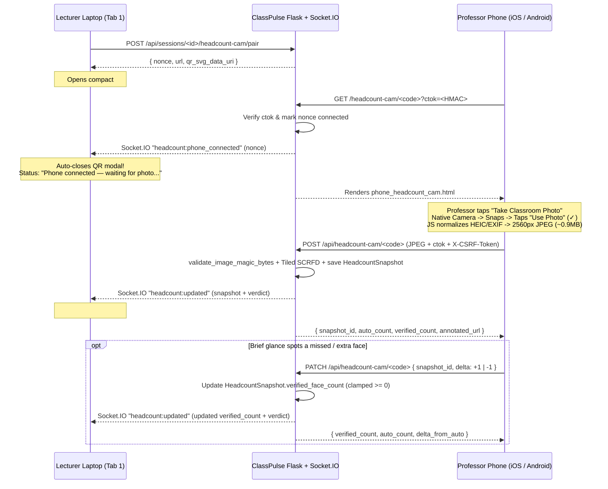

# ClassPulse Professor Phone Headcount Companion — Design & Implementation Plan

**Status:** Completed & Verified (Phases P1–P4 Implemented)  
**Git Branch:** `proffesor-phone` (branched from `NEW-UI` @ `6aa46e7`)  
**Stack Constraint:** Python 3.12 · Flask 3.1.3 · Flask-SocketIO 5.7.2 · Jinja2 · Pure CSS3 · Vanilla JS (No external frontend frameworks or build steps)  
**Primary Files in Scope:**
- `app/services/qr_service.py` (scoped camera pairing tokens)
- `app/routes/attendance.py` (pairing, phone camera view, upload, annotated preview, `+1`/`-1` stepper, Socket.IO broadcasts)
- `app/templates/phone_headcount_cam.html` *(new mobile companion view)*
- `app/templates/teacher_portal.html` (Tab 1 `"Phone Camera"` button, compact QR modal with auto-close, live Socket.IO/polling sync)
- `app/static/js/headcount_canvas.js` (preserve explicit `verifiedCount` when adjusted via phone `+1`/`-1`)
- `app/static/css/classpulse.css` (phone camera companion card + stepper styles)
- `tests/test_phone_headcount_cam.py` *(new automated test suite)*

---

## 1. Executive Summary & Locked UX Decisions

Instead of taking a classroom photo on a phone, transferring it to a laptop, and manually uploading it from disk, the professor can pair their phone directly to the active lecture's **AI Classroom Face Counter** in one scan.

This blueprint implements the three locked product decisions:
1. **Flavor 1 — Instant Auto-Send After Native Camera Confirmation:** On both iPhone (iOS Safari) and Android (Chrome), tapping **"Take Classroom Photo"** opens the native OS camera (`<input type="file" accept="image/*" capture="environment">`). The moment the professor taps the OS camera's native **"Use Photo" (✓)** confirmation, the page automatically normalizes the image (solving iPhone HEIC + EXIF rotation + large file size), uploads it, and runs `Tiled SCRFD` face detection—no redundant second confirm step.
2. **Compact Laptop QR Modal with Automatic Close on Connect:** A **"Phone Camera"** button sits right next to the PC upload controls in Tab 1 (`AI Classroom Face Counter`). Clicking it opens a compact QR modal (`#modal-phone-headcount-qr`). The instant the server detects the professor's phone opened the paired link, the QR modal **closes automatically** and switches Tab 1's status indicator to `"Phone connected — waiting for photo..."`.
3. **Brief-Look `+1` / `-1` Quick Adjust on Phone:** After the scan completes, the phone shows the annotated classroom preview and detected count alongside two thumb-friendly **`- 1`** and **`+ 1`** buttons so if a quick glance shows the detector missed or double-counted a student, the professor can nudge the verified count by 1 at a time—syncing live to the laptop's KPIs and audit verdict.

---

## 2. End-to-End Architecture & Sequence Flow



---

## 3. Security, Pairing Tokens & Multi-Tenant Isolation

Because the professor's phone is typically **not logged into `/teacher`**, authentication uses a short-lived, least-privilege capability token (`ctok`) following the exact pattern of `create_projector_token()` in `app/services/qr_service.py`:

### 3.1 Scoped Companion Token (`app/services/qr_service.py`)
- Add a dedicated `URLSafeTimedSerializer` on `DeviceBindingManager`:
  - Salt: `"classpulse-headcount-cam-v1"`
  - `create_headcount_cam_token(session_id: int, session_code: str, lecturer_id: int, nonce: str) -> str`
  - `verify_headcount_cam_token(token: Optional[str], session_code: str, max_age: int = 1800) -> Optional[dict[str, Any]]` (30-minute default TTL).
- **Least-Privilege Scope:** `ctok` ONLY authorizes:
  - `GET /headcount-cam/<session_code>` (companion UI)
  - `POST /api/headcount-cam/<session_code>` (upload photo for that session)
  - `GET /api/headcount-cam/<session_code>/image/<int:snap_id>` (fetch annotated JPEG for that session)
  - `PATCH /api/headcount-cam/<session_code>` (adjust `verified_face_count` by `+1`/`-1` on that session's snapshot)
  - It **cannot** read student lists, emails, polls, homework, or any other course/session.
- **Public URL Guarantee:** Pairing URLs are built using `_resolve_base_url()` so the QR always resolves through the active Cloudflare HTTPS Tunnel (`PUBLIC_BASE_URL` / forwarded host) on cellular 5G or university Wi-Fi.
- **CSRF Compliance:** `phone_headcount_cam.html` sets `` (via `layouts/base.html`), so the `GET` response sets `cp_csrf` and all phone `POST`/`PATCH` calls automatically include `X-CSRF-Token` without weakening global CSRF enforcement.
- **Laptop-Only QR Display:** The pairing QR is **never** shown on `/projector/<session_code>`; it only appears briefly inside the lecturer's private Tab 1 modal and auto-closes immediately once scanned.

### 3.2 In-Memory Thread-Safe Pairing Nonce Registry
- Store a lightweight thread-safe dict on `current_app.extensions["headcount_cam_pairings"]` (protected by a `threading.Lock`, auto-pruning entries older than 60 minutes, zero DB migration needed):
  ```python
  {
      nonce: {
          "session_id": int,
          "session_code": str,
          "lecturer_id": int,
          "created_at": float,
          "connected": bool,
          "connected_at": Optional[float],
          "revoked": bool,
      }
  }
  ```
- When `GET /headcount-cam/<session_code>?ctok=...` succeeds:
  1. Verify `ctok` signature, TTL, matching `session_code`, and that `nonce` is not revoked.
  2. Mark `pairing["connected"] = True` and record `connected_at`.
  3. Emit `socketio.emit("headcount:phone_connected", {"session_id": session.id, "session_code": session.session_code, "nonce": nonce}, to=f"session_{session.session_code}")`.
- Clicking **"New QR"** in the modal marks the previous `nonce` as `revoked = True` and issues a fresh one.

---

## 4. Backend API & Socket.IO Specification (`app/routes/attendance.py`)

| Endpoint | Auth | Purpose |
|---|---|---|
| `POST /api/sessions/<int:session_id>/headcount-cam/pair` | `require_session_access` (Lecturer cookie) | Creates a fresh `nonce` + `ctok`, builds public URL & QR SVG (`qr_service.generate_svg_data_uri`), returns `{ nonce, url, svg_data_uri, expires_in_seconds }`. |
| `GET /api/sessions/<int:session_id>/headcount-cam/pair/<nonce>/status` | `require_session_access` (Lecturer cookie) | Polling fallback while QR modal is open; returns `{ connected, connected_at, latest_snapshot_id }`. |
| `GET /headcount-cam/<session_code>?ctok=...` | `ctok` (query param) | Renders `phone_headcount_cam.html` (or friendly expired-link card on invalid/expired `ctok`), marks `nonce` connected, and broadcasts `headcount:phone_connected`. |
| `POST /api/headcount-cam/<session_code>` | `ctok` (header `X-Headcount-Token` or form `ctok`) | Validates JPEG/PNG/WebP magic bytes, runs `Tiled SCRFD` + `render_annotated_image`, saves `HeadcountSnapshot`, broadcasts `headcount:updated` to `session_<code>`, and returns `{ snapshot_id, auto_count, verified_count, annotated_image_url, verdict }`. |
| `GET /api/headcount-cam/<session_code>/image/<int:snap_id>?ctok=...` | `ctok` (query param) | Streams the annotated JPEG for `snap_id` (verifying `snap.session_id == session.id`) for the phone's quick visual check. |
| `PATCH /api/headcount-cam/<session_code>` | `ctok` (`X-Headcount-Token` or JSON `ctok`) | Accepts `{ "snapshot_id": int (optional), "delta": 1 | -1 }` (strictly `+1` or `-1`, or explicit `verified_face_count >= 0`), updates `snap.verified_face_count = max(0, snap.verified_face_count + delta)`, commits, broadcasts `headcount:updated`, and returns `{ snapshot_id, auto_count, verified_count, verdict }`. |

**Shared Refactoring Note:**
- Extract a small helper `_run_headcount_detection_and_persist(db, cfg, detector, att_service, session, raw_dest, ann_dest)` inside `app/routes/attendance.py` so both the existing PC upload (`POST /api/sessions/<id>/headcount`) and the new phone upload (`POST /api/headcount-cam/<code>`) share identical detection, persistence, verdict calculation, and `headcount:updated` Socket.IO emission logic—zero duplicated pipeline code!
- Also emit `headcount:updated` from existing desktop `PATCH /api/sessions/<id>/headcount` so any open lecturer tab stays synchronized.

---

## 5. Phone Companion Web App (`app/templates/phone_headcount_cam.html`)

Designed with ClassPulse's frosted-glass mobile design system (`layouts/base.html` + `classpulse.css`, edge-to-edge on phones, `100dvh`, `env(safe-area-inset-bottom)`):

### 5.1 Reliable iPhone + Android Client-Side Image Pipeline (JS)
When the professor taps **"Take Classroom Photo"** (`<input type="file" id="cam-capture-input" accept="image/*" capture="environment">`) and confirms **"Use Photo" (✓)** in the OS camera:
1. **`change` event fires immediately (Flavor 1 — zero extra confirm screen).**
2. **Client-Side Normalization (`normalizePhotoToJpeg(file)`):**
   - Primary path: `const bitmap = await createImageBitmap(file, { imageOrientation: "from-image" })` (handles iPhone `HEIC` decoding and bakes EXIF portrait/landscape orientation upright into pixels).
   - Fallback path (older browsers): `URL.createObjectURL(file)` -> `Image` decode.
   - Compute scaled dimensions capping the longest edge at **`2560px`** (preserving aspect ratio, never upscaling smaller images).
   - Draw to offscreen `<canvas>` and export `canvas.toBlob(..., "image/jpeg", 0.90)` (~`600KB–1.2MB`, crisp for `Tiled SCRFD`, uploads in `<1s` over Cloudflare Tunnel).
   - Retain `lastNormalizedBlob` in memory until replaced so network hiccups can be retried in 1 tap without re-shooting the room!
3. **Auto-Upload:** `POST /api/headcount-cam/<session_code>` via `FormData` with `X-Headcount-Token: <ctok>`.

### 5.2 Phone UI Wireframe & States

```
STATE 1: READY TO SHOOT                     STATE 2: SCAN RESULT + QUICK ADJUST (±1)
┌─────────────────────────────────┐         ┌─────────────────────────────────┐
│ ● ClassPulse  [ARIEL1]          │         │ ● ClassPulse  [ARIEL1]          │
│ Lecture 2 — Adapter Pattern     │         │ Lecture 2 — Adapter Pattern     │
├─────────────────────────────────┤         ├─────────────────────────────────┤
│                                 │         │ ┌─────────────────────────────┐ │
│   ┌─────────────────────────┐   │         │ │ [Annotated Classroom Photo] │ │
│   │         ( 📷 )          │   │         │ │  green boxes over detected  │ │
│   │  Point camera at class  │   │         │ │  faces for a brief glance   │ │
│   │  and tap Use Photo —    │   │         │ └─────────────────────────────┘ │
│   │  scans automatically.   │   │         │                                 │
│   │                         │   │         │      VERIFIED HEADCOUNT         │
│   │ [ 📷 Take Classroom Photo]│  │         │  ┌─────┐               ┌─────┐ │
│   │                         │   │         │  │ - 1 │      34       │ + 1 │ │
│   │   Choose from Gallery   │   │         │  └─────┘               └─────┘ │
│   └─────────────────────────┘   │         │     Model detected: 33 (+1)     │
│                                 │         │    ✓ Synced to Lecture Laptop   │
│                                 │         │                                 │
│                                 │         │  [ 📷 Retake Classroom Photo ]  │
└─────────────────────────────────┘         └─────────────────────────────────┘
```

- **State Transitions:**
  - **Uploading / Scanning:** Displays instant local preview of the snapped photo + subtle overlay spinner (`"Optimizing photo..."` -> `"Scanning faces on server..."`).
  - **Network Error:** Keeps `lastNormalizedBlob` and displays `"Upload failed — check Wi-Fi"` + **"Retry Upload"** + **"Retake"**.
  - **Brief-Look `− 1` / `+ 1` Stepper:**
    - Large `54×54px` thumb-friendly buttons flanking the big tabular count (`#phone-verified-count`).
    - Serialized queue / in-flight lock so rapid taps (`+1`, `+1`) never race or lose a step; disabled at `0` for `− 1`.
    - Displays subtle comparison subtitle (`"Model detected: 33"` -> `"Model detected: 33 (+1 manual)"` or `"(-1 manual)"`).
    - Immediately shows `"✓ Synced to Lecture Laptop"` upon `200 OK`.

---

## 6. Desktop Lecturer Portal & Canvas Editor Integration

### 6.1 Tab 1 Button & Auto-Closing QR Modal (`app/templates/teacher_portal.html`)
- Right next to `"Upload & Count Faces"` (line ~314), add a crisp button:
  ```html
  <button type="button" id="btn-open-phone-cam-qr" class="cp-btn cp-btn--indigo cp-btn--sm" onclick="openPhoneHeadcountQr()">
    {{ cp_icon('smartphone', 14) }}
    <span>Phone Camera</span>
  </button>
  ```
- Add compact modal `#modal-phone-headcount-qr` (`.cp-modal-card`, `max-width: 380px`):
  - Header: `"Scan with Your Phone"` + close `×` button.
  - Pure-white `.cp-qr-island` displaying `#phone-cam-qr-img` (`svg_data_uri`).
  - Live waiting status indicator (`"Waiting for phone to scan..."`).
  - Secondary `"New QR"` button (rotates nonce) and compact copyable URL fallback.
- **Auto-Close Behavior:**
  - When `openPhoneHeadcountQr()` opens the modal, it stores `ACTIVE_PHONE_PAIR_NONCE` and starts a lightweight `1.2s` interval polling `/api/sessions/${SESSION_ID}/headcount-cam/pair/${nonce}/status`.
  - Meanwhile, `socket.on("headcount:phone_connected", (payload) => ...)` listens on `session_<SESSION_CODE>`.
  - Whichever arrives first (`Socket.IO` in ~50ms, or polling within `1.2s` if WebSockets are blocked):
    1. Automatically calls `closePhoneHeadcountQr()` (hides modal + stops polling).
    2. Updates `#cv-status` to `"Phone connected — waiting for photo..."`.

### 6.2 Live Photo & `+1`/`-1` Count Sync (`teacher_portal.html` & `headcount_canvas.js`)
- **Critical `HeadcountCanvasEditor` Fix (`app/static/js/headcount_canvas.js`):**
  - Currently `drawCanvas()` overwrites `#kpi-visual` and `#snap-verified-count` with `String(this.currentBoxes.length)`.
  - Update `HeadcountCanvasEditor` to track `this.verifiedCount`:
    - `loadSnapshot(data)` sets `this.verifiedCount = data.verified_count ?? data.verified_face_count ?? boxes.length` and `this.snapshotId = data.snapshot_id ?? data.id ?? null`.
    - `drawCanvas()` renders `String(this.verifiedCount)` to `#kpi-visual`, `#kpi-visual-count`, and `#snap-verified-count` (and `#snap-auto-count` gets `String(this.autoCount)`).
    - Clicking the desktop canvas (`handleClick`) updates `this.verifiedCount = this.currentBoxes.length` before redrawing & syncing boxes—preserving 100% of existing desktop interactive box editing!
    - Add a small `setVerifiedCount(count)` helper for `+1`/`-1` updates arriving from the phone without reloading the whole canvas image unnecessarily!
- **Desktop Realtime + Fallback Sync (`teacher_portal.html`):**
  - `socket.on("headcount:updated", (data) => ...)`:
    - If `data.snapshot_id !== lastLoadedSnapId` and `data.image_url`: calls `editor.loadSnapshot(data)`, updates `#cv-status` (`"Phone photo received — detected X faces"`).
    - Otherwise (same snapshot, `+1`/`-1` adjustment): calls `editor.setVerifiedCount(data.verified_count)` and updates `#cv-status` (`"Count adjusted from phone: Y"`).
    - Always calls `applyVerdict(data.verdict)` to update `#kpi-visual`, `#kpi-delta`, and `#audit-badge`.
  - Inside `refreshOverview()`: compare `data.snapshot.id` and `data.snapshot.verified_face_count` against the currently loaded snapshot state so even without WebSockets, phone photos and `+1`/`-1` adjustments appear on the laptop within ~3 seconds automatically!

---

## 7. Phased Implementation Plan

### Phase P1: Scoped Pairing Tokens & Backend Endpoints (`qr_service.py`, `attendance.py`)
- Add `create_headcount_cam_token()` and `verify_headcount_cam_token()` to `DeviceBindingManager`.
- Refactor headcount detection/persistence into a shared helper in `attendance.py` emitting `headcount:updated`.
- Implement pairing registry + all 6 routes (`pair`, `pair/<nonce>/status`, `GET /headcount-cam/<code>`, `POST /api/headcount-cam/<code>`, `GET /api/headcount-cam/<code>/image/<snap_id>`, `PATCH /api/headcount-cam/<code>`).

### Phase P2: Phone Camera Companion UI (`phone_headcount_cam.html`, `classpulse.css`)
- Build the frosted-glass mobile companion page with native `<input capture="environment">` + Gallery fallback.
- Implement `normalizePhotoToJpeg()` (`createImageBitmap` EXIF/HEIC -> `2560px` JPEG) + Flavor 1 instant auto-upload + network retry buffer.
- Implement the scan result view with annotated preview image, `− 1` / `+ 1` stepper buttons (serialized requests + floor at `0`), and `"Retake Classroom Photo"`.

### Phase P3: Desktop Lecturer Tab 1 QR Modal & Live Sync (`teacher_portal.html`, `headcount_canvas.js`)
- Add `"Phone Camera"` button next to PC upload + compact `#modal-phone-headcount-qr` with auto-close on `headcount:phone_connected` / status poll.
- Update `HeadcountCanvasEditor` to honor explicit `verifiedCount` alongside box editing.
- Wire `socket.on("headcount:updated", ...)` and `refreshOverview()` snapshot diffing.

### Phase P4: Automated Tests, E2E Verification & Docker Deployment
- Create `tests/test_phone_headcount_cam.py` covering pairing security, auto-connect status flip, photo upload, `+1`/`-1` count adjustments & floor-at-0, invalid files, cross-lecturer/cross-session rejection (`403`), and CSRF enforcement.
- Run full `python run_all_tests.py` and `python scripts/e2e_ui_verify.py --tier all` (verifying zero regressions on all existing desktop/mobile views + verifying `#modal-phone-headcount-qr` and `/headcount-cam/<code>`).
- Rebuild running Docker container (`docker compose up -d --build web`) so the live Cloudflare tunnel serves the feature immediately for real iPhone/Android testing.
