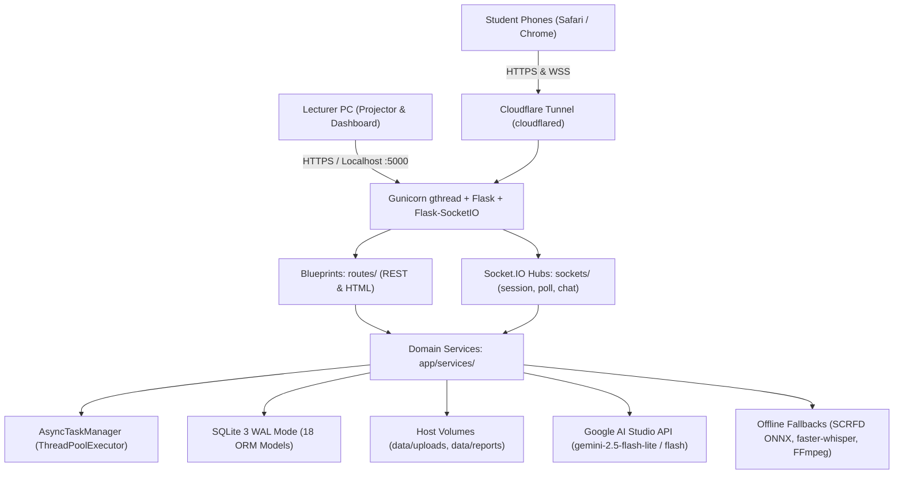
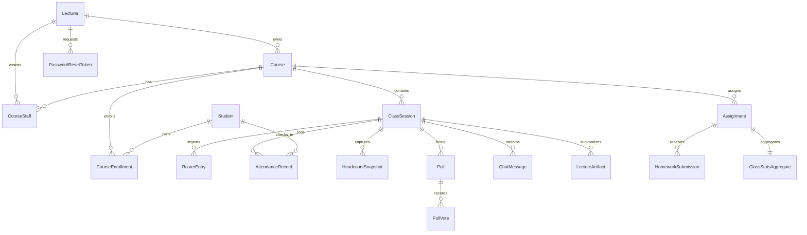

# Software Design & Architecture (SDD) — ClassPulse

**Chain Role:** `3. SDD (Architect)` — *How is the system structured?*  
**Upstream:** [`docs/software_requirements_specification_srs.md`](software_requirements_specification_srs.md) | **Downstream:** [`docs/engineering_design_edd.md`](engineering_design_edd.md)

---

## 1. System Architecture Overview

ClassPulse is a **Layered Modular Monolith** packaged inside Docker Compose (`web` + `cloudflared`). Heavy CV and AI workloads execute asynchronously via `AsyncTaskManager` (`ThreadPoolExecutor`) so Gunicorn `gthread` keeps 5s QR rotation, live polls, and Socket.IO messaging responsive.

---

## 2. Layered Module Map

| Layer | Path | Modules & Responsibility |
| :--- | :--- | :--- |
| **App Factory & Config** | `app/__init__.py`, `app/config.py` | Creates Flask/SocketIO app, ProxyFix, CSRF middleware, Swagger/OpenAPI `/api/docs`, env config (`validate_production_safety`). |
| **REST & Views** | `app/routes/` | `courses.py` (auth, courses, staff, enrollments, student UI), `attendance.py` (QR, check-in, headcount, phone cam, reports), `polls.py`, `chat.py`, `lectures.py`, `homework.py`, `guards.py` (`401`/`403` isolation). |
| **Real-Time Events** | `app/sockets/` | `session_events.py` (`join_session`, `join_notifications`, `qr:rotate`), `poll_events.py` (`poll:vote`, `poll:sync`), `chat_events.py` (`chat:send`, `chat:upvote`). |
| **Domain Services** | `app/services/` | `course_service.py`, `identity_helpers.py`, `rate_limiter.py`, `qr_service.py`, `attendance_service.py`, `face_counter.py`, `reconciler.py`, `report_exporter.py`, `poll_service.py`, `chat_service.py`, `lecture_pipeline.py`, `homework_pipeline.py`, `llm_client.py`, `task_runner.py`. |
| **Persistence** | `app/models.py` | 18 SQLAlchemy 2.0 Declarative ORM models on SQLite WAL. |
| **Zero-Build UI** | `app/templates/`, `app/static/` | Jinja2 HTML + `classpulse.css` + 4 vanilla JS modules (`csrf.js`, `notifications.js`, `image_compress.js`, `headcount_canvas.js`). |

---

## 3. Data Model (18 ORM Models)

| Domain | Models (`app/models.py`) | Key Constraints |
| :--- | :--- | :--- |
| **Auth & Security** | `Lecturer`, `PasswordResetToken`, `AuditLog` | `token_version` invalidates all cookies on password change/`logout-all`; 5-failure lockout. |
| **Courses & Staff** | `Course`, `CourseStaff`, `CourseEnrollment` | Unique `course_code`, unique `join_code`, enrollment states (`pending`/`approved`/`rejected`). |
| **Attendance & CV** | `ClassSession`, `Student`, `RosterEntry`, `AttendanceRecord`, `HeadcountSnapshot` | Composite unique `(session_id, student_id)` and `(session_id, device_id)` prevent proxy check-in. |
| **Live Class** | `Poll`, `PollVote`, `ChatMessage` | Unique `(poll_id, student_id)` enforces single vote; `ChatMessage.offset_seconds` tracks `+MM:SS`. |
| **AI & Assignments** | `LectureArtifact`, `Assignment`, `HomeworkSubmission`, `ClassStatsAggregate` | `LectureArtifact.is_published` gates student visibility; `HomeworkSubmission.submission_type` separates `comparative` from `final`. |

---

## 4. Security & Data Isolation Architecture

1. **Dual Signed Cookies:** `cp_lecturer` (validated against `Lecturer.token_version`) and `cp_device` (`HttpOnly`, `SameSite=Lax`, HMAC-signed `(device_id, student_id)`).
2. **Route & Room Guards (`app/routes/guards.py`):** Every course/session/lecture/assignment route verifies ownership, `CourseStaff` membership, or approved `CourseEnrollment`; Socket.IO `join_session` blocks unauthorized tenants with `session:error`.
3. **CSRF Protection:** Double-submit `cp_csrf` cookie + `X-CSRF-Token` header automatically attached by `csrf.js`.
4. **Phone Camera Scoped Token (`ctok`):** Short-lived HMAC token bound to `(session_code, session_id, nonce)` revocable on QR rotation.
5. **Comparative Privacy Boundary:** Lecturers querying `/api/courses/<id>/assignments`, `/api/assignments/<id>`, `/api/submissions/<id>/download`, or `/deep-review` are strictly restricted to `submission_type="final"` (`403` on comparative files).

---

## 5. Technology Stack & Verification Baseline

| Subsystem | Technology Chosen | Key Engineering Rationale |
| :--- | :--- | :--- |
| **Web + WS Server** | Flask 3 + Flask-SocketIO (`simple-websocket` + Gunicorn `gthread`) | Avoids `eventlet`/`gevent` monkey-patching conflicts with C-extension AI libraries (`onnxruntime`, `faster-whisper`) on Python 3.12. |
| **Database** | SQLite 3 (WAL mode) + SQLAlchemy 2.0 | Zero-config single-file volume; verified concurrent 50-thread burst writes (`busy_timeout`). |
| **Tunnel** | `cloudflare/cloudflared` | Free HTTPS/WSS (`*.trycloudflare.com` quick tunnel or named `TUNNEL_TOKEN`) with zero browser interstitial breaking phone QR scans. |
| **CV Headcount** | InsightFace SCRFD (`det_10g` ONNX) + CPU `onnxruntime` | Small/distant lecture-hall face recall on CPU; empirical benchmark on Ariel hall photo recorded in [`reports/tool_verification_results.md`](../reports/tool_verification_results.md). |
| **Audio / LLM** | `ffmpeg` + Google Gemini (`google-genai`) + `faster-whisper` fallback | Native multimodal audio transcription + structured Pydantic JSON outputs with automatic offline fallback. |
| **Frontend** | Vanilla HTML/CSS/JS | Zero build pipeline, zero `node_modules` bloat, fast container builds. |
