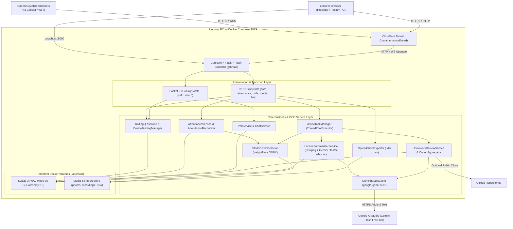
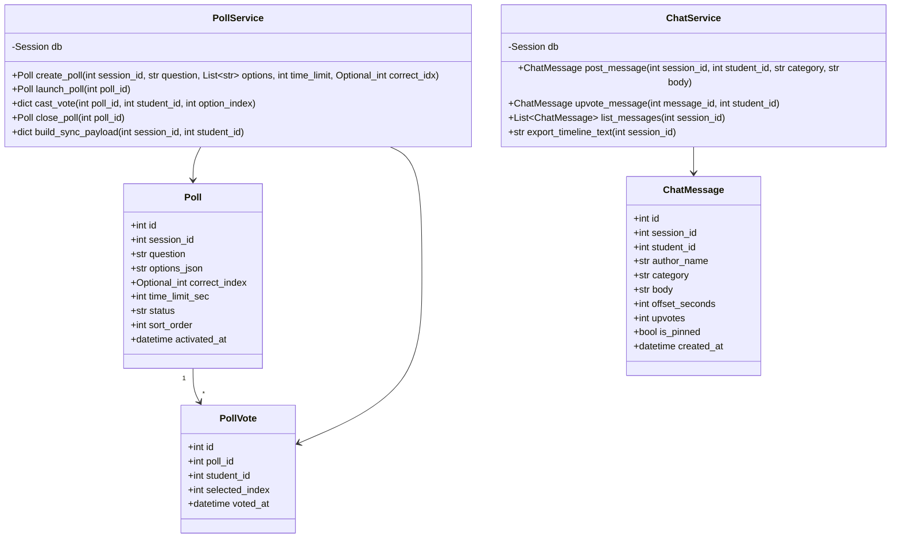
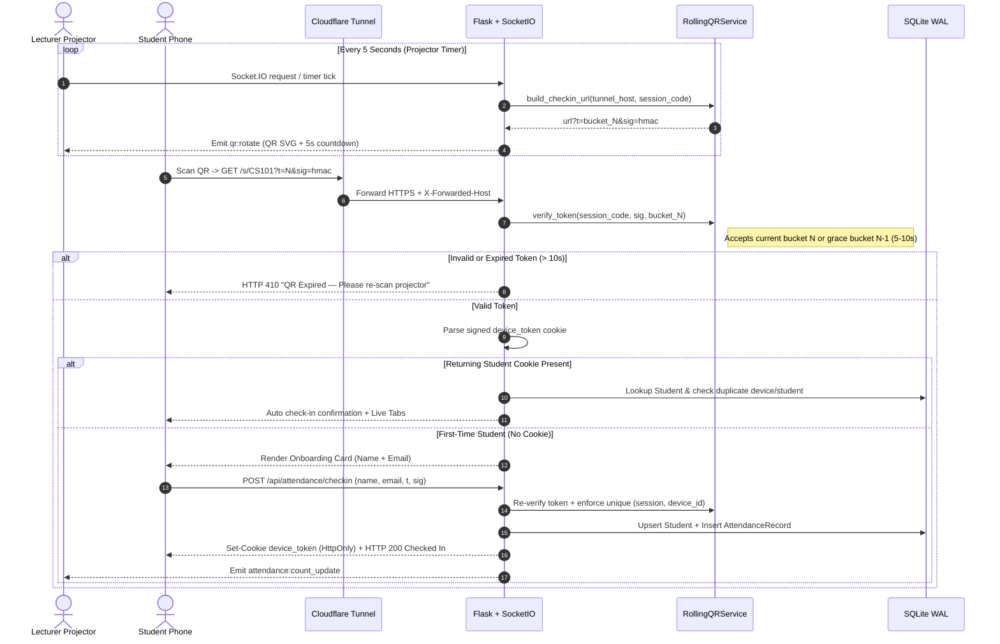
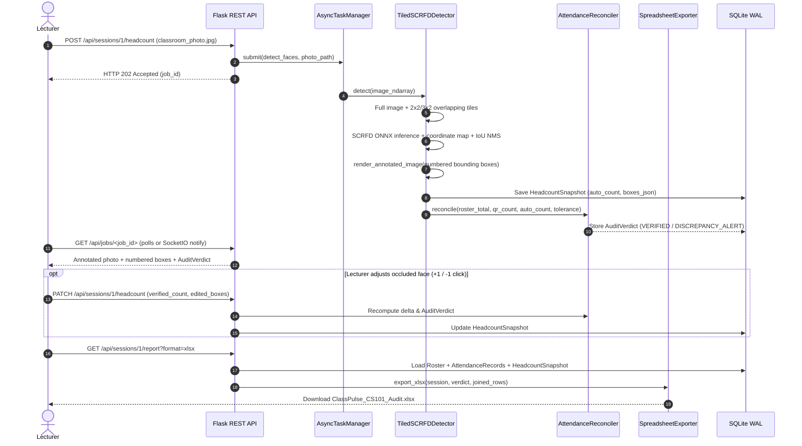
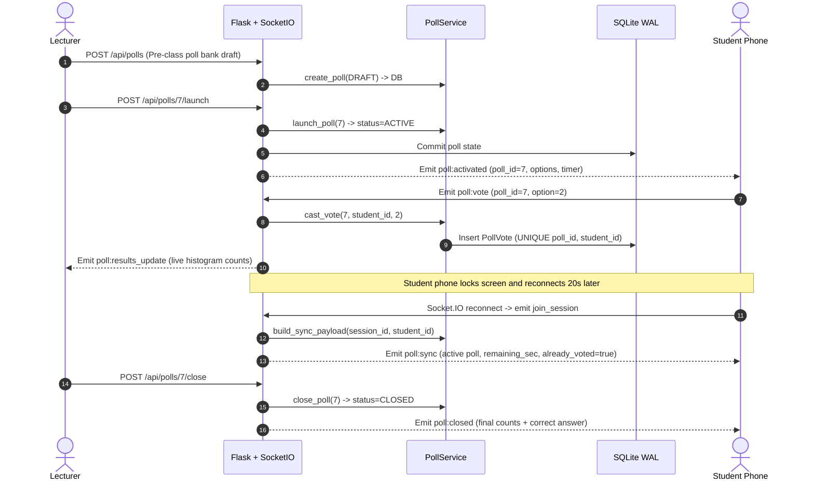
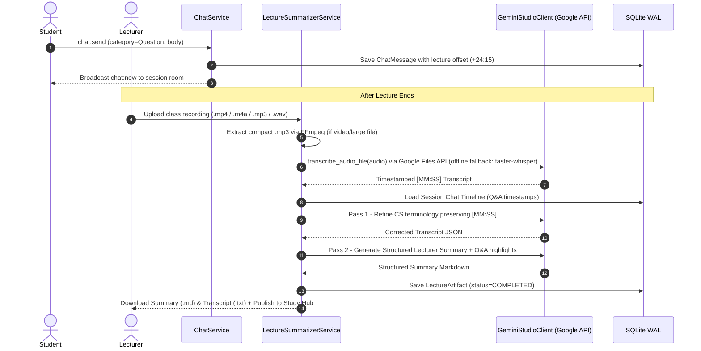
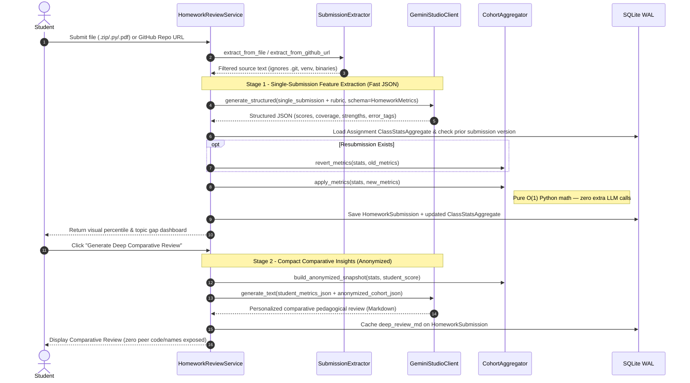

# Software Design & Architecture — ClassPulse

**Document ID:** `Ex1-SDD-1.0`  
**Course:** Introduction to Software Engineering (OOP / OOD) — Ex2 (To-Do #7 & #8)  
**Author:** Ohad Ben Nun

---

## 1. Main Software Components (To-Do #7)

ClassPulse follows a **Layered Modular Monolith** packaged inside Docker Compose on the lecturer's PC. Heavy CPU/API workloads (SCRFD face counting, `faster-whisper` transcription, Gemini LLM pipelines) run asynchronously on a bounded `ThreadPoolExecutor` so the Flask + Flask-SocketIO (`simple-websocket` + `gthread`) server remains non-blocking for 5-second QR rotation, live polls, and chat.

### Component Responsibility Matrix

| Component | Package / Module | Core Responsibility |
| :--- | :--- | :--- |
| **Ingress Tunnel** | `cloudflared` container | Terminates public HTTPS/WSS (`*.trycloudflare.com` or custom domain) with zero interstitial pages and forwards `X-Forwarded-*` headers to Flask. |
| **Web & Socket.IO Hub** | `app/routes/`, `app/sockets/` | Serves mobile-first student views and lecturer dashboard; manages WebSocket rooms (`session_<id>`) and reconnect state hydration (`poll:sync`). |
| **QR & Anti-Proxy Security** | `RollingQRService`, `DeviceBindingManager` | Generates 5-second HMAC-SHA256 rolling tokens, validates 2-bucket grace windows (`t`, `t-1`), and signs/verifies `HttpOnly` device cookies. |
| **Attendance & Reconciliation** | `AttendanceService`, `AttendanceReconciler`, `SpreadsheetExporter` | Onboards first-time students (`Name + Email`), imports optional roster CSVs, computes QR vs Visual Headcount delta $\Delta$, and exports styled `.xlsx`/`.csv`. |
| **CV Face Counter** | `FaceDetector` -> `TiledSCRFDDetector` | Runs InsightFace SCRFD (`det_10g` ONNX) across full image + overlapping tiles + IoU NMS; draws numbered bounding boxes for interactive lecturer review. |
| **Live Polls & Chat** | `PollService`, `ChatService` | Manages pre-class poll banks, quick polls, idempotent votes, timestamped chat feeds (`+MM:SS`), upvotes, and the Live Q&A Companion Popout. |
| **AI Lecture Summarizer** | `LectureSummarizerService` | Preps uploaded recordings via `ffmpeg`, transcribes via **Google Gemini API** (`files.upload`, offline `faster-whisper` fallback), and generates lecturer summaries + `.md`/`.txt` exports. |
| **Homework Incremental AI** | `SubmissionExtractor`, `CohortAggregator`, `HomeworkReviewService` | Extracts files/GitHub repos, gets Stage-1 Pydantic JSON metrics, updates anonymized `ClassStatsAggregate` in $O(1)$ math (with resubmission subtraction), and runs Stage-2 comparative review. |
| **Async Task Runner** | `AsyncTaskManager` | Bounded `ThreadPoolExecutor` tracking long-running CV/Whisper/LLM jobs (`PENDING`, `RUNNING`, `DONE`, `FAILED`) without blocking live Socket.IO traffic. |

---

## 2. Low-Level Class Diagrams (To-Do #8)

To preserve clarity and readability, the low-level Object-Oriented Design is partitioned into three cohesive class diagrams matching the system layers.

### 2.1 Domain Models & Feature 1 Core (Attendance, CV Headcount & Reporting)

```mermaid
classDiagram
    class ClassSession {
        +int id
        +str session_code
        +str title
        +datetime started_at
        +bool attendance_open
        +int headcount_tolerance
        +bool is_active()
    }

    class Student {
        +int id
        +str full_name
        +str email
        +str primary_device_id
        +datetime created_at
    }

    class RosterEntry {
        +int id
        +int session_id
        +str full_name
        +str email
    }

    class AttendanceRecord {
        +int id
        +int session_id
        +int student_id
        +str device_id
        +datetime checked_in_at
        +bool is_late
        +str token_bucket
    }

    class HeadcountSnapshot {
        +int id
        +int session_id
        +str raw_image_path
        +str annotated_image_path
        +int auto_face_count
        +int verified_face_count
        +str boxes_json
        +datetime captured_at
    }

    class BoundingBox {
        +int label_id
        +float x1
        +float y1
        +float x2
        +float y2
        +float confidence
        +str source
        +float iou(BoundingBox other)
    }

    class AuditVerdict {
        +int roster_total
        +int qr_count
        +int visual_count
        +int delta
        +str status
        +str summary_note
    }

    class RollingQRService {
        -bytes secret_key
        -int step_seconds
        -int grace_buckets
        +int compute_bucket(float timestamp)
        +str sign_token(str session_code, int bucket)
        +bool verify_token(str session_code, str token, int bucket)
        +str build_checkin_url(str base_url, str session_code)
    }

    class DeviceBindingManager {
        -str signer_salt
        +str create_device_cookie(str device_id, int student_id)
        +Optional_tuple parse_device_cookie(str cookie_val)
    }

    class FaceDetector {
        <<interface>>
        +List~BoundingBox~ detect(ndarray image)*
    }

    class TiledSCRFDDetector {
        -str model_path
        -float conf_threshold
        -float nms_iou_threshold
        -tuple grid_shape
        +List~BoundingBox~ detect(ndarray image)
        -List~tuple~ _generate_tiles(int width, int height)
        -List~BoundingBox~ _apply_nms(List~BoundingBox~ boxes)
        +str render_annotated_image(str image_path, List~BoundingBox~ boxes, str out_path)
    }

    class AttendanceService {
        -Session db
        -RollingQRService qr_service
        -DeviceBindingManager device_mgr
        +AttendanceRecord process_checkin(str session_code, int bucket, str token, str name, str email, str device_id)
        +int import_roster_csv(int session_id, str csv_content)
        +AuditVerdict get_audit_summary(int session_id)
    }

    class AttendanceReconciler {
        +AuditVerdict reconcile(int roster_total, int qr_count, int visual_count, int tolerance)
    }

    class SpreadsheetExporter {
        +bytes export_xlsx(ClassSession session, AuditVerdict verdict, List~dict~ rows)
        +str export_csv(ClassSession session, AuditVerdict verdict, List~dict~ rows)
    }

    ClassSession "1" --> "*" AttendanceRecord
    ClassSession "1" --> "*" RosterEntry
    ClassSession "1" --> "*" HeadcountSnapshot
    Student "1" --> "*" AttendanceRecord
    FaceDetector <|.. TiledSCRFDDetector
    TiledSCRFDDetector ..> BoundingBox : produces
    AttendanceService --> RollingQRService
    AttendanceService --> DeviceBindingManager
    AttendanceService --> AttendanceReconciler
    AttendanceReconciler ..> AuditVerdict : returns
    SpreadsheetExporter ..> AuditVerdict : formats
```

### 2.2 Features 2 & 3 (Real-Time Polls & Timestamped Classroom Chat)

### 2.3 Features 4 & 5 (Google Gemini Lecture Transcriber/Summarizer & Incremental Homework Review)

```mermaid
classDiagram
    class GeminiStudioClient {
        -str api_key
        -str fast_model
        -str pro_model
        -float min_interval_sec
        +str generate_text(str prompt, str system_instruction)
        +T generate_structured(str prompt, type schema_cls, str system_instruction)
        +str transcribe_audio_file(Path audio_path, str prompt, str system_instruction)
        -Any _generate_with_model_fallback(str requested_model, callable fn)
    }

    class LectureArtifact {
        +int id
        +int session_id
        +str source_type
        +str media_path
        +str raw_transcript_json
        +str corrected_transcript_json
        +str summary_markdown
        +str status
        +Optional_str error_message
    }

    class LectureSummarizerService {
        -Session db
        -GeminiStudioClient llm_client
        +List~dict~ transcribe_media_file(Path media_path)
        +LectureArtifact summarize_session_recording(int session_id, Path media_path)
        +tuple build_summary_download(int artifact_id)
        +tuple build_transcript_download(int artifact_id)
    }

    LectureSummarizerService --> GeminiStudioClient
    LectureSummarizerService --> LectureArtifact

    class Assignment {
        +int id
        +str title
        +str rubric_text
        +str topics_json
        +datetime created_at
    }

    class HomeworkSubmission {
        +int id
        +int assignment_id
        +int student_id
        +int version
        +str source_type
        +str source_ref
        +str metrics_json
        +str deep_review_md
        +datetime submitted_at
    }

    class ClassStatsAggregate {
        +int assignment_id
        +int submission_count
        +float mean_overall_score
        +str topic_sums_json
        +str scores_list_json
        +str error_tag_counts_json
        +datetime updated_at
    }

    class HomeworkMetrics {
        +float overall_score
        +Dict~str, float~ topic_scores
        +float requirements_coverage_pct
        +List~str~ strengths
        +List~str~ weaknesses
        +List~str~ error_tags
        +str style_summary
    }

    class SubmissionExtractor {
        -int max_chars
        +str extract_from_file(str file_path)
        +str extract_from_github_url(str repo_url)
    }

    class CohortAggregator {
        +ClassStatsAggregate apply_metrics(ClassStatsAggregate stats, HomeworkMetrics metrics)
        +ClassStatsAggregate revert_metrics(ClassStatsAggregate stats, HomeworkMetrics old_metrics)
        +dict build_anonymized_snapshot(ClassStatsAggregate stats, float student_score)
    }

    class HomeworkReviewService {
        -Session db
        -LLMClient llm
        -SubmissionExtractor extractor
        -CohortAggregator aggregator
        +HomeworkSubmission process_submission(int assignment_id, int student_id, str source_type, str source_ref)
        +str generate_deep_review(int submission_id)
    }

    class AsyncTaskManager {
        -ThreadPoolExecutor pool
        -Dict~str, dict~ jobs
        +str submit(str job_name, callable fn, tuple args)
        +dict get_status(str job_id)
    }

    LLMClient <|.. GeminiStudioClient
    LectureSummarizerService --> LLMClient
    LectureSummarizerService --> LectureArtifact
    Assignment "1" --> "*" HomeworkSubmission
    Assignment "1" --> "1" ClassStatsAggregate
    HomeworkReviewService --> LLMClient
    HomeworkReviewService --> SubmissionExtractor
    HomeworkReviewService --> CohortAggregator
    HomeworkReviewService ..> HomeworkMetrics : validates via Pydantic
```

---

## 3. Sequence Diagrams (To-Do #8)

### 3.1 Feature 1A — 5-Second Rolling QR Attendance & First-Time Student Sign-In

### 3.2 Feature 1B — Classroom Photo Headcount & Cross-Reference Audit Report

### 3.3 Feature 3 — Reconnect-Safe Real-Time Polls (`Flask-SocketIO`)

### 3.4 Feature 2 & Feature 4 — Classroom Chat & Google Gemini Lecture Summarizer

### 3.5 Feature 5 — Homework Incremental JSON Aggregation & Deep Comparative Review

